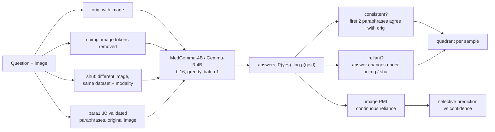

<h1 align="center">Consistent but Blind?</h1>
<p align="center"><b>A modality-by-modality audit of image reliance in a small medical vision-language model</b></p>
<p align="center">
MedGemma-4B &nbsp;·&nbsp; CT · MRI · X-ray · pathology &nbsp;·&nbsp; SLAKE · VQA-RAD · PathVQA &nbsp;·&nbsp; pre-registered analysis
</p>

---

## Abstract

Medical VQA benchmarks score a model on whether its answer is right, not on whether it **looked at the
image** to get there. A model can be accurate *and* stable under rewording while answering from language
priors alone, the failure mode recently called *consistent but dangerous* for chest X-rays. We ask whether
this holds beyond chest X-rays. We audit **MedGemma-4B**, an open medical VLM, on **3,365 questions over
907 images** spanning CT, MRI, X-ray and pathology. Every question is asked four ways: with its image,
with **no image** (image tokens removed), with a **different image** of the same modality, and in
**independently validated paraphrases**. Crossing *stable under paraphrase* with *changes when the image
changes* places every answer in one of four quadrants. A continuous reliance score (image PMI) asks whether
image reliance can **flag wrong answers better than the model's own confidence**, and an architecture-matched
control (**Gemma-3-4B**, no medical post-training) asks whether medical tuning makes this better or worse.
Hypotheses, endpoints, tests and exclusions were [pre-registered](PLAN.md) before the main run, and
every post-hoc analysis is labelled as such. Medical tuning makes MedGemma far more accurate and consistent,
**and** far more willing to answer when the image is missing. The result is more answers that look
trustworthy without the image. The reliance score we pre-registered to catch them turns out to work only
because it reads the answer key.

## Key findings

*18,896 model calls per model, all completed. Primary set: 1,206 yes/no test questions on 670 images. Full
write-up with every number and CI: **[RESULTS.md](RESULTS.md)**.*

1. **Medical tuning creates the *consistent but blind* pattern, across modalities.** Under the
   pre-registered image-removed probe, MedGemma has **+13.7 points** more Dangerous answers than its
   architecture twin Gemma-3 (95% CI [10.0, 17.5]), in every dataset (pathology +7.5, SLAKE +18.6,
   VQA-RAD +25.6) and across the whole sensitivity grid. On yes/no questions much of any Dangerous share is
   chance agreement (floor ~36–42%); corrected for chance the gap holds (Δκ = +0.11 [0.04, 0.18]) but is
   smaller. See the [audit of every leak and assumption](RESULTS.md#9-audit-leaks-confounds-and-wrong-assumptions).
2. **It is not ignoring images; it is answering without them.** When an image is swapped for one with a
   different correct answer, MedGemma changes its answer 74% of the time (Gemma-3: 17%). But when the image
   is *missing*, Gemma-3 asks for it ("please provide the image") on up to 50% of questions and MedGemma
   keeps answering, beating the answer-frequency prior on PathVQA (+5.0 points, Holm-significant).
3. **"Dangerous" depends on the probe.** With a wrong image instead of no image, the model gap vanishes
   (−0.7 points), the two probes agree poorly (κ ≤ 0.23), and wrong-image swaps are confounded wherever the
   other image has the same answer (all chest X-rays checked).
4. **A reliance score that looks great is a label leak.** Image PMI on the gold answer flags errors with
   AUROC 0.92. On the model's own answer, the only deployable version, it is at chance (0.51), below plain
   confidence (0.71). The pre-registered P2 had this flaw; we report it rather than the flattering number.

<p align="center"></p>

---

## 1. Why this question

A yes/no medical VQA set with 55% "yes" answers rewards a model that never opens the image. Accuracy alone
cannot tell *seeing* from *guessing well*, and paraphrase consistency cannot either: a model that ignores
the image is often *more* consistent, because nothing visual perturbs it. The two have to be measured
**together and per sample**:

|  | **Answer changes without the image** (image-reliant) | **Answer stays the same without the image** (not reliant) |
|---|---|---|
| **Stable under paraphrase** | **Ideal**: grounded and robust | **Dangerous**: looks trustworthy, ignores the image |
| **Flips under paraphrase** | **Fragile**: looks, but wording-sensitive | **Worst**: neither |

*Dangerous* answers are the ones a clinician would trust and should not. The reference work
([arXiv 2603.20985](https://arxiv.org/abs/2603.20985), CVPR-W 2026) introduced this taxonomy on chest X-rays,
for yes/no questions, with one binary probe. This audit extends it along four axes:

1. **Modalities:** CT, MRI, X-ray *and* pathology, compared with image-level uncertainty.
2. **Two probes of reliance:** *image removed* and *wrong image*, which fail differently. Removing image
   tokens is out-of-distribution input; a mismatched image is not. We measure how much the two agree.
3. **A continuous signal:** image PMI, $\log p(\text{gold}\mid \text{image}, q) - \log p(\text{gold}\mid \varnothing, q)$,
   instead of a binary flip. It also exists for open-ended answers.
4. **A causal-ish control:** Gemma-3-4B shares MedGemma's architecture without the medical post-training,
   so differences between them are attributable to that tuning rather than to the architecture.

## 2. Research questions

| | Question | Test |
|---|---|---|
| **Q1** | Does MedGemma answer *without the image* better than answer frequencies alone would allow? | **P1**: blind accuracy minus majority prior, per dataset (yes/no) |
| **Q2** | How large is the *Dangerous* share per modality, and does it depend on how reliance is probed? | Descriptive with CIs; probe agreement (Cohen's κ) |
| **Q3** | Does image reliance flag wrong answers better than the model's own confidence? | **P2**: ΔAUROC (PMI vs confidence) for predicting correctness |
| **Q4** | Does medical post-training change the Dangerous share? | **P3**: paired MedGemma − Gemma-3 difference |

Directional hypotheses (H1–H5) and the pilot's hints are in [PLAN.md §3](PLAN.md). Null results are
reported as findings.

## 3. Method



**Prompts and decoding.** One prompt template for every condition ("Answer with only 'yes' or 'no'." /
"Answer with a single word or short phrase."), greedy decoding. Yes/no answers come from a single forward
pass: $P(\text{yes}) = \sigma(\text{logsumexp}(\text{yes tokens}) - \text{logsumexp}(\text{no tokens}))$, and the raw
yes+no probability mass is logged as a format check. Open answers are scored by token-F1 after
normalisation, with an **opposite-term guard** (left/right, upper/lower, anterior/posterior, ... mismatches
score 0, so "right lung" never matches "left lung").

**Paraphrases.** Paraphrase consistency is only meaningful if a paraphrase cannot change the correct answer.
Candidates come from Qwen2.5-3B-Instruct (five styles) and from deterministic templates that copy every
content word ("Is there X?" → "Is X present?"). They pass a rule validator (laterality, negation, absence
words, quantities, antonyms, imaging planes, question form, answer leakage, near-copies), and then **every
unique (question, paraphrase) pair, 4,890 in total, was judged for semantic equivalence** against a written
rubric. 1,208 pairs were rejected, each with a recorded reason (e.g. *mass → lesion*, *is enlarged → can
be enlarged*, *does A show B → is A associated with B*). The judgments are committed and enforced
fail-closed: an unjudged paraphrase is never used. 84% of the primary-set questions keep at least two
valid paraphrases. The full audit trail, including two failed rounds and a validator bug it uncovered, is in
[PLAN.md §4.5](PLAN.md).

**Statistics.** The unit of resampling is the **image** (cluster bootstrap, B = 2,000), because several
questions share one image and naive intervals are too narrow. A simulation in the test suite shows the
clustered intervals reach nominal coverage where naive ones do not. Four primary tests (P1 ×3, P2) are
Holm-corrected. P3 is a separate family. Everything else is descriptive with 95% CIs. A finding is called
**robust** only if its sign survives the pre-specified sensitivity grid (F1 threshold 0.3 / 0.5 / 0.8 ×
1 / 2 / 3 paraphrases × strong flips only).

## 4. Why these models

| | Choice | Reason |
|---|---|---|
| **Audited model** | `google/medgemma-4b-it` | A leading openly available medical VLM, at a size one consumer GPU runs **unquantized** (bf16, 8.6 GB). Quantizing would perturb exactly the probabilities being audited. It is also a realistic deployment candidate: small, open, and marketed for medical use, which is where an audit matters. Its model card reports SLAKE and VQA-RAD scores, which serve as an external sanity check on our pipeline. |
| **Control** | `google/gemma-3-4b-it` | The same architecture and size with no medical post-training. A Dangerous-share difference between the two is attributable to medical tuning, not to architecture or scale, which comparing two unrelated VLMs could not show. |
| **Paraphraser** | `Qwen/Qwen2.5-3B-Instruct` + templates | A different model family from the audited one, so paraphrases are not written in MedGemma's own style. Small enough to run alongside the audit; its errors are caught by the rules and the judge pass. |

## 5. Data

| Dataset | Modality | Questions used | Notes |
|---|---|---|---|
| [SLAKE](https://www.med-vqa.com/slake/) (EN) | CT · MRI · X-ray | 2,114 (test + validation) | Only dataset with modality labels; validation added so each modality has enough images (53–82). Listed in MedGemma's training data, which we state as a confound. |
| [VQA-RAD](https://osf.io/89kps/) | radiology | 451 (test) | Clinician-written questions; loaded from the original OSF release. |
| [PathVQA](https://github.com/UCSD-AI4H/PathVQA) | pathology | 800 (600 yes/no + 200 open, seeded) | Questions generated from textbook captions; open questions exploratory. |

The primary analysis set is the 1,206 yes/no test questions on 670 images. Sampling, wrong-image partners
and image hashes are fixed in `manifests/main/` and SHA-1-seeded, so every run uses identical inputs.

## 6. Making the measurement trustworthy

An audit is only as credible as its instrument. Before any main-run number existed:

- **Pre-registration.** Endpoints, tests, exclusions and the robustness rule were frozen. Every later change
  is logged with its reason ([PLAN.md §13](PLAN.md)).
- **Pilot used for design only.** 330 questions on a Colab T4 tuned the scoring and validator. None of its
  numbers are reported as results.
- **Numerical determinism.** We found that bf16 batching shifts teacher-forced log-probabilities by up to
  ~1 nat even with no padding, while yes/no probabilities are unaffected. An fp32 LM head did not help, so
  the cause is inside the network. All runs therefore use batch size 1, and a regression check confirms a
  different GPU reproduces the pilot (98.5% same answers, mean |ΔP(yes)| = 0.004).
- **Paraphrase validity.** Every pair was screened, not sampled (above), and the result is enforced in code.
- **Engineering.** 90 unit tests plus real-model equivalence tests; resumable, crash-safe runs; a
  timestamped log for every command.

## 7. Repository

```
RESULTS.md         findings: pre-registered endpoints, post-hoc analyses, figures
PLAN.md            pre-registration, design decisions and lab notebook (the source of truth)
docs/REPRODUCE.md  how to run everything, from a fresh clone
configs/           base -> profile -> model -> hardware layering
manifests/         exact questions, image hashes, paraphrases, judgments, audit sheets
src/medvlm/        data/ (loaders, sampler), models/ (HF backend), paraphrase.py, run.py, analysis/ (stats, tables)
tests/             fast unit tests + -m slow real-model tests
results/           analysis tables per model and profile
```

Quick start: see **[docs/REPRODUCE.md](docs/REPRODUCE.md)**. The short version is
`pip install -e ".[model,dev]"`, then `medvlm pipeline --profile main --model medgemma4b`.

## 8. Limitations

- One audited model; Gemma-3 is a control, not a population of models.
- SLAKE appears in MedGemma's training data (split unspecified), so dataset comparisons are confounded by
  possible contamination.
- Removing image tokens is out-of-distribution input. The wrong-image probe addresses this but does not
  settle it, which is why both are reported along with their agreement.
- Paraphrase equivalence was judged by an LLM (Claude), not by clinicians. A human spot-check bounds its
  error. Quadrant results cover questions with at least two valid paraphrases (84% of the primary set).
- PathVQA questions are auto-generated from captions and often ungrammatical.
- Benchmark VQA is not clinical use. Nothing here is a clinical claim.

## 9. Related work

- *Consistent but Dangerous*, [arXiv 2603.20985](https://arxiv.org/abs/2603.20985): the four-quadrant
  taxonomy on chest X-rays (MIMIC-CXR, PadChest), yes/no, image-removal probe.
- *PSF-Med*, [arXiv 2602.21428](https://arxiv.org/abs/2602.21428): paraphrase sensitivity on chest X-rays.
  A low flip rate does not imply visual grounding.
- *Why Does Grounding Hurt Medical VQA?*, [arXiv 2604.27720](https://arxiv.org/abs/2604.27720):
  MedGemma-4B and Lingshu-7B on SLAKE with grounding inputs.
- *HEAL-MedVQA*, [arXiv 2505.00744](https://arxiv.org/abs/2505.00744), and *MedHEval*,
  [arXiv 2503.02157](https://arxiv.org/abs/2503.02157): shortcut-learning and hallucination benchmarks.

## 10. Licences and citation

SLAKE (CC-BY-4.0), VQA-RAD (CC0 1.0), PathVQA (MIT); MedGemma and Gemma-3 under Google's terms. Cite the
original dataset papers in any use of this work. Term project for a computer vision course, 2026.

```bibtex
@misc{consistentbutblind2026,
  title  = {Consistent but Blind? A Modality-by-Modality Audit of Image Reliance in a Small Medical VLM},
  author = {Thái, Hữu Trí},
  year   = {2026},
  url    = {https://github.com/thaitri2005/Medvlm-Image-Reliance}
}
```
