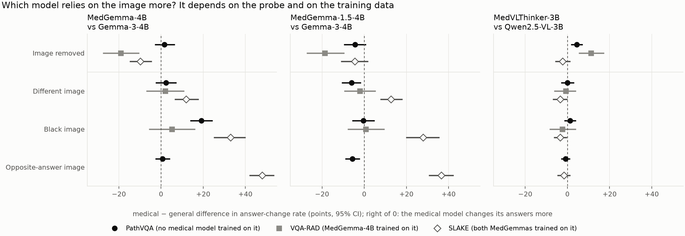
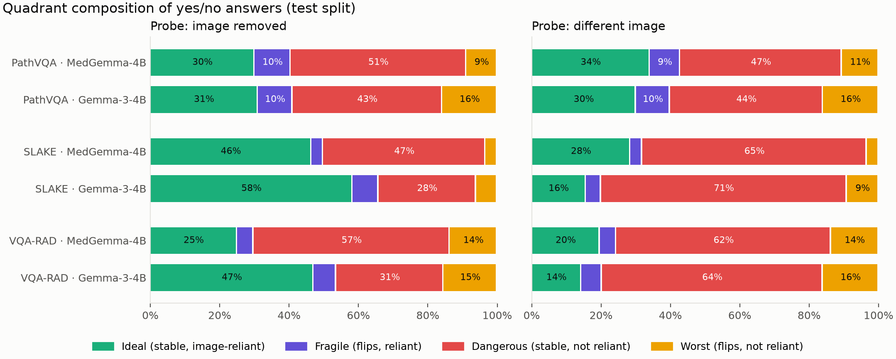
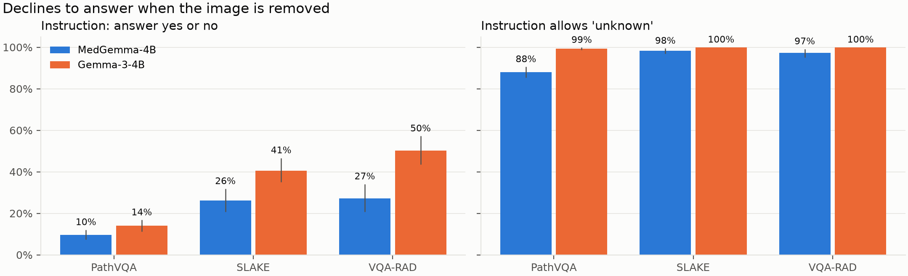
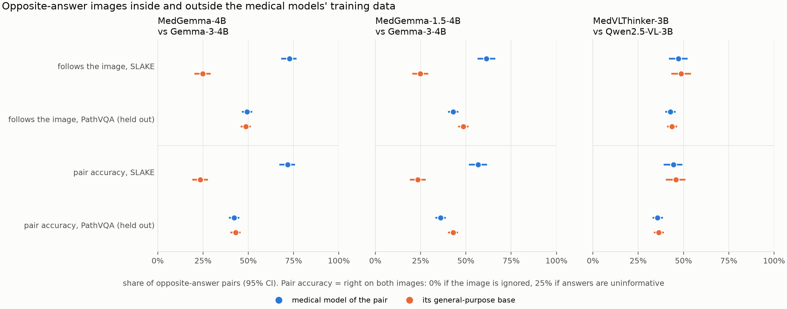
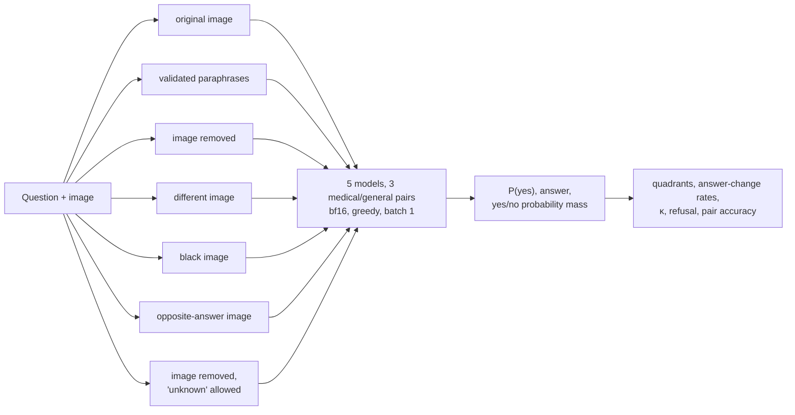

<h1 align="center">Consistent but Blind?</h1>
<p align="center"><b>Probes of image reliance disagree in medical vision-language models</b></p>
<p align="center"><b>Tri Thai Huu</b>, <b>Hung Nguyen Le</b> · VinUniversity · <a href="mailto:23tri.th@vinuni.edu.vn">23tri.th@vinuni.edu.vn</a>, <a href="mailto:23hung.nl@vinuni.edu.vn">23hung.nl@vinuni.edu.vn</a></p>
<p align="center">
5 models: 3 medical VLMs vs the 2 general-purpose models they derive from &nbsp;·&nbsp; SLAKE · VQA-RAD · PathVQA &nbsp;·&nbsp; CT · MRI · X-ray · pathology &nbsp;·&nbsp; pre-registered
</p>
<p align="center">
<a href="report/main.pdf"><b>Paper (PDF)</b></a> &nbsp;·&nbsp; <a href="report/poster/poster.pdf">Poster</a> &nbsp;·&nbsp; <a href="docs/RESULTS.md">All results</a> &nbsp;·&nbsp;
<a href="docs/PREREGISTRATION.md">Pre-registration</a> &nbsp;·&nbsp; <a href="docs/REPRODUCE.md">Reproduce</a>
</p>

**Does a medical vision-language model look at the image? The answer depends on how you ask.** Removing the
image says MedGemma relies on the image *less* than the general model it was built from. Swapping the image for
one that requires the opposite answer says it relies on the image *far more*, on the same questions, on SLAKE, a
dataset MedGemma was trained on. On held-out data no such disagreement is shown.

<p align="center"></p>

<p align="center"><sub><i>Dangerous</i>: the answer survives rephrasing and does not change when the image is altered.
<i>Ideal</i>: it survives rephrasing and does change. Actual model outputs.</sub></p>

> **TL;DR.** A recent taxonomy calls a medical VLM answer *dangerous* when it survives rephrasing and does not
> change when the image is removed. We ran that probe next to three probes that swap the image instead (a
> different image, a black image, an image whose correct answer is the opposite), on the same questions, for
> three medical VLMs and the general-purpose models they were built from.
>
> **What we found.** The probes are not interchangeable. In 6 of 9 model-pair × dataset combinations they
> measure a different gap between the two models, and on SLAKE the sign flips: image removal puts MedGemma-4B
> behind its base, the opposite-answer image puts it 48 points ahead. The opposite-answer probe turns out to
> equal accuracy on questions where guessing the usual answer scores exactly 50%.
>
> **What we did not find.** The flip appears only on SLAKE, which MedGemma was trained on. On held-out
> pathology data no disagreement is shown between image removal and the probes that change what the image
> shows, and none of those probes puts the medical models ahead. Refusing to answer without an image explains part of image removal's behaviour, not all of it.

*Engineering in three lines: a resumable inference engine (about 120,000 model calls on one 16 GB GPU); every
table and figure regenerated on a CPU from committed model outputs; 105 tests, including a simulation of the
statistics. [More below.](#engineering)*

---

## The finding in one figure

<p align="center"></p>

Each point is a **medical − general** difference in how often a yes/no answer changes when the image is
altered. Right of zero, the medical model changes its answers more often, so it looks more image-reliant. Rows
are probes, markers are datasets, panels are model pairs.

| Probe | What the model sees | What it is good for |
|---|---|---|
| **Image removed** | the question, no image | the taxonomy's criterion |
| **Different image** | a random image of the same dataset and modality | weak: the new image often has the same answer |
| **Black image** | a black image | keeps the input format; not a neutral input |
| **Opposite-answer image** | an image on which the *same question* has the opposite answer | the reference: a model that uses the image must change its answer, and to the right one |

- **If the probes measured one thing, the markers of a dataset would line up vertically in each panel.** On
  SLAKE (open diamonds) they do the opposite for both MedGemma models: left of zero when the image is removed,
  far right under every probe that keeps an image.
- **The MedGemma advantage is on SLAKE, which both MedGemma models were trained on.** On PathVQA (filled
  circles), which no medical model was trained on, the probes that change image content agree that the models do
  not differ.
- **No probe is treated as ground truth.** The opposite-answer image exists only where a question recurs on
  another image with the opposite answer: on SLAKE and PathVQA, not on VQA-RAD.

## Why this matters

Medical VQA benchmarks score whether an answer is right, not whether the model looked. A model can reach a
correct "yes" from language priors and be wrong on exactly the patient whose image is unusual. *Consistent but
Dangerous* ([Sadanandan & Behzadan, 2026](https://arxiv.org/abs/2603.20985)) addressed this by crossing two
per-answer tests:

|  | **Answer changes without the image** | **Answer unchanged without the image** |
|---|---|---|
| **Stable under paraphrase** | **Ideal** | **Dangerous**: trustworthy-looking, image-independent |
| **Flips under paraphrase** | **Fragile** | **Worst** |

A taxonomy like this invites model comparisons ("is the medical model more *Dangerous* than the general one?").
This project asks whether its reliance criterion, removing the image, gives the same answer as probes that keep
an image, and finds that for these models it does not.

## Results

*1,206 yes/no test questions on 670 images, five models. Intervals are 95% confidence intervals from a
bootstrap over images. Results marked "registered" had their test fixed in a git tag before the run; "post hoc"
results were analysed afterwards. Every number: [docs/RESULTS.md](docs/RESULTS.md).*

**1. By image removal, MedGemma looks more "consistent but blind"** (registered). MedGemma-4B's *Dangerous*
share is **13.7 points** higher than Gemma-3's [10.0, 17.5], in every dataset (MedGemma-1.5: +9.8). Left panel:
MedGemma's red segment is larger everywhere. Right panel: with a different image instead, the difference is gone.

<p align="center"></p>

**2. Image removal and probes that keep an image measure different gaps** (post hoc). "Significant under one
probe, not under another" is not evidence that two probes disagree, so the disagreement is tested directly: the
medical − general gap under image removal **minus** the gap under a probe that keeps an image (an *in-format*
probe), on the same questions. Zero means the two probes measure the same gap; negative means image removal makes
the medical model look less reliant than the other probe does.

| Image removal − in-format probe (points) | Dataset | Different image | Black image | Opposite-answer image |
|---|---|---|---|---|
| MedGemma-4B vs Gemma-3 | PathVQA | −0.7 [−7.1, 5.9] | **−17.5** [−23.8, −10.8] | −5.6 [−22.6, 10.9] |
| | VQA-RAD | **−21.1** [−32.2, −9.6] | **−24.3** [−36.3, −11.7] | |
| | SLAKE | **−21.7** [−30.5, −13.3] ⇄ | **−42.8** [−52.1, −33.0] ⇄ | **−60.5** [−68.8, −51.3] ⇄ |
| MedGemma-1.5 vs Gemma-3 | PathVQA | +1.7 [−4.8, 8.0] | −4.0 [−9.5, 1.7] | +3.7 [−14.2, 21.4] |
| | VQA-RAD | **−16.7** [−26.0, −6.7] | **−19.5** [−29.6, −9.2] | |
| | SLAKE | **−17.2** [−26.2, −8.7] | **−32.4** [−41.8, −23.0] | **−45.5** [−56.5, −34.0] ⇄ |
| MedVLThinker vs Qwen2.5-VL | PathVQA | +4.5 [0.5, 8.5] | +3.2 [0.0, 6.4] | +0.9 [−9.2, 11.7] |
| | VQA-RAD | **+12.0** [4.3, 20.0] | **+13.5** [6.1, 21.5] | |
| | SLAKE | +1.1 [−4.0, 6.7] | +1.1 [−2.0, 4.7] | +1.6 [−2.1, 5.5] |

Bold: significant after Holm correction over all 24 comparisons (13 of 24, in 6 of the 9 model-pair × dataset
combinations). ⇄: a sign flip
(a *reversal* in the paper), meaning each probe finds a difference on its own and the two have opposite signs.

- **The sign flips on SLAKE only**: for MedGemma-4B against every in-format probe, and for MedGemma-1.5 against
  the opposite-answer image.
- **On VQA-RAD, only image removal reports a difference.** VQA-RAD has no opposite-answer images, so the
  comparison there is with the two weaker probes.
- **On held-out PathVQA no disagreement is shown** with either probe that changes what the image shows (a
  different image, an opposite-answer image). The intervals are too wide to call it agreement.
- A non-zero entry shows two probes are not interchangeable; only a sign flip shows they order models
  differently.

**3. Refusal biases image removal and accounts for part of one pair's difference** (post hoc). Told to answer yes or no about
an image it was not given, Gemma-3 asks for the image on 29% of questions (MedGemma-4B 18%, MedGemma-1.5 under
1%, the Qwen models never). Its forced answers there are unrelated to its answers with the image, so about half
count as "image-reliant", and the model that refuses more looks more reliant. But dropping every question
either model refuses removes most of the answer-change difference only for MedGemma-1.5 (−7.4 → −2.3 points), whose *Dangerous*
gap mostly remains (+7.5 of +9.8); for MedGemma-4B most of both stays (−6.1 → −4.5), and the Qwen pair differs
with no refusals at all.

<p align="center"></p>

**4. The opposite-answer probe is accuracy where guessing cannot help, and its MedGemma advantage does not
appear on held-out data** (identity: post hoc; held-out test: registered). On opposite-answer pairs the answers
are balanced by construction, so a model that ignores the image and guesses the usual answer is right exactly
half the time, and

`share of pairs where the answer changes = 2 × accuracy on those images − 1 + 2 × share wrong on both`

exactly. The probe therefore measures accuracy where priors cannot help, which is what makes it the most direct
probe, and it inherits whatever makes a model accurate on a dataset, including having been trained on it.

| Answer changes with an opposite-answer image | SLAKE (in MedGemma training data) | PathVQA (held out) |
|---|---|---|
| MedGemma-4B − Gemma-3 | **+48.0** [41.9, 53.8] | +0.8 [−2.7, 4.2] |
| MedGemma-1.5 − Gemma-3 | **+36.5** [30.6, 42.1] | −5.6 [−9.1, −2.0] |
| MedVLThinker − Qwen2.5-VL | −1.6 [−4.9, 1.4] | −0.9 [−3.0, 1.3] |

Under the decision rule fixed before the run, the claim that the MedGemma models use the image more is not
supported on held-out data. PathVQA is hard for every model (64–69% accuracy on these pairs, where ignoring the
image gives 50%), so "no difference" there may mean equal difficulty as much as equal reliance. In the figure,
"pair accuracy" is the share of pairs answered correctly on both images.

<p align="center"></p>

**Also in [docs/RESULTS.md](docs/RESULTS.md):** what the *Dangerous* share contains (a chance floor of 36–42%
on yes/no questions; MedGemma's excess is in correct answers, but a larger share of its errors are the stable,
image-independent kind); and a negative result, that image reliance does not flag wrong answers (AUROC 0.51,
where the model's own confidence reaches 0.71).

### Registered tests

Each test was fixed in a git tag before its run ([docs/PREREGISTRATION.md](docs/PREREGISTRATION.md)). Failed
predictions are reported as such. The last column is the test's identifier in the pre-registration.

| Test | Estimate [95% CI] | Outcome | ID |
|---|---|---|---|
| *Dangerous* share, MedGemma-4B − Gemma-3, image removed | +13.7 [10.0, 17.5], p < 0.001 | MedGemma higher | P3 |
| MedGemma-4B accuracy without the image − majority-answer prior: PathVQA | +5.0 [0.9, 8.8], p_Holm = 0.042 | above the prior | P1a |
| … SLAKE; VQA-RAD | −3.1 [−7.8, 1.8]; +7.6 [0.4, 14.5], p_Holm = 0.072 | not significant | P1b–c |
| Does image reliance flag errors better than confidence? (AUROC difference) | −0.197 [−0.250, −0.145] | no, worse | P2 |
| Agreement between answers with the real and a black image, MedGemma-4B − Gemma-3 (predicted > 0) | −0.22 [−0.30, −0.14] | **failed, reversed** | H6 |
| Declines when "unknown" is allowed, MedGemma-4B − Gemma-3 (predicted < 0) | −6.7 [−8.2, −5.3] | supported; both ≥ 93% | H7 |
| Follows an opposite-answer image on SLAKE, MedGemma-4B − Gemma-3 (predicted > 0) | +48.0 [41.9, 53.8] | supported | H8 |
| Same three effects in the two added pairs | MedGemma-1.5: +36.5, −7.4, −28.7; MedVLThinker: −1.6, +3.9, 0.0 | MedGemma-1.5 only | H9–H11 |
| Follows an opposite-answer image on PathVQA, MedGemma-4B − Gemma-3 (predicted > 0) | +0.8 [−2.7, 4.2] | **not supported** | H12a |
| … MedGemma-1.5 − Gemma-3 (predicted > 0) | −5.6 [−9.1, −2.0] | **reversed** ¹ | H12b |
| … MedVLThinker − Qwen2.5-VL (predicted within ±5) | −0.9 [−3.0, 1.3] | supported ¹ | H12c |

¹ Under the registered bootstrap over images. Resampling question templates instead, which is more conservative
because the questions reuse templates, widens both intervals (the first is then not significant after
correction, the second slightly exceeds ±5); the conclusion that the MedGemma models are not ahead is unchanged.

### What to take away

1. Name the probe. A *Dangerous* share measured by image removal is not interchangeable with one measured with
   an image in the input, and on a model's training data the two can point in opposite directions.
2. Prefer images whose correct answer is the opposite, and read the result as what it is: accuracy with the
   answer prior removed.
3. Run the comparison on data **outside** each model's training set.
4. Test whether two probes agree directly; don't compare their significance.
5. Let models abstain, and treat declining without an image as desirable, not as a format failure.

## Method



The four probes are described under the figure at the top. A fifth condition removes the image and extends the
instruction with "If this cannot be determined without seeing the image, answer 'unknown'", to measure refusal
separately. In the docs and file names the probes carry their registration identifiers: `shuf` (different image),
R1 (black image), R2 ("unknown" allowed), R3 and R4 (opposite-answer image on SLAKE and on PathVQA).

- **Models.** Three pairs, each a medical model and the general model it shares an architecture with:
  [`google/medgemma-4b-it`](https://huggingface.co/google/medgemma-4b-it) and
  [`google/medgemma-1.5-4b-it`](https://huggingface.co/google/medgemma-1.5-4b-it) vs
  [`google/gemma-3-4b-it`](https://huggingface.co/google/gemma-3-4b-it), and
  [`UCSC-VLAA/MedVLThinker-3B-RL_PMC`](https://huggingface.co/UCSC-VLAA/MedVLThinker-3B-RL_PMC) vs its base
  [`Qwen/Qwen2.5-VL-3B-Instruct`](https://huggingface.co/Qwen/Qwen2.5-VL-3B-Instruct). All run unquantised in
  bf16 with identical prompts and scoring; each added model passed a registered format check first.
- **Data.** [SLAKE](https://www.med-vqa.com/slake/) (CT, MRI, X-ray), [VQA-RAD](https://osf.io/89kps/)
  (radiology), [PathVQA](https://github.com/UCSD-AI4H/PathVQA) (pathology): 3,365 questions on 907 images,
  plus 1,192 PathVQA questions on 682 images for the held-out opposite-answer probe. All are sampled once with SHA-1 seeds and fixed in
  `manifests/`. What each model was trained on is documented in [docs/RESULTS.md §13](docs/RESULTS.md).
- **Scoring.** Yes/no answers come from one forward pass,
  `P(yes) = sigmoid(logsumexp(yes-token logits) - logsumexp(no-token logits))`,
  and the yes+no probability mass detects refusals. Open answers are scored by token-F1 with an opposite-term
  guard (left/right, upper/lower and similar pairs never match).
- **Paraphrases.** Generated by Qwen2.5-3B-Instruct plus content-copying templates, filtered by a rule
  validator. **Every one of the 4,890 unique (question, paraphrase) pairs was judged for equivalence** by an LLM
  (Claude) against a written rubric: 1,208 were rejected, each with a reason, and unjudged pairs are rejected by
  construction. No independent human rater validated the judgments (see Limitations). Only the quadrant
  results use paraphrases; the comparison between probes does not.
- **Statistics.** Cluster bootstrap over images (B = 2,000), Holm correction within families, Cohen's κ for
  chance agreement, a difference-of-differences test for whether two probes report the same difference, and template-clustered
  sensitivity checks for the opposite-answer probes.

## Engineering

The audit runs on one consumer GPU from a fresh clone, and every number in the paper is regenerated by a
command.

**Stack:** Python · PyTorch · Hugging Face Transformers · bf16 inference on one 16 GB GPU (RTX 4080 SUPER) ·
pandas · NumPy · scikit-learn · matplotlib · pytest · LaTeX (CVPR kit)

- **Resumable inference engine.** Each job is one (question, condition) pair keyed by ID and appended to a
  per-host JSONL log, so a crashed or interrupted run continues where it stopped, and runs split across
  machines merge. About 120,000 model calls across five models; 18,896 calls per model in about 75 min
  (0.23 s/call, 8.2 GB peak).
- **Deterministic inputs.** Dataset loaders, seeded sampling, SHA-checked images and committed manifests: every
  run on every machine sees byte-identical prompts and images.
- **Numerical determinism.** Pre-flight showed that in bf16 the **batch size** alone shifts teacher-forced
  log-probabilities by up to 1.09 nats on identical, unpadded inputs, and an fp32 output head does not fix it.
  All runs use batch size 1; a regression check reproduces the T4 pilot on the 4080 (98.5% identical answers).
- **One backend, two model families.** Gemma 3 and Qwen2.5-VL run through the same Hugging Face code path, and
  the backend tests are parameterised by model (including a random-weight Qwen for CPU tests).
- **A paraphrase pipeline** with generation, rule validation and LLM-judged equivalence, enforced fail-closed.
- **Statistics as code.** Cluster bootstrap, Holm, κ and every analysis live in one tested package; a simulation
  test shows the clustered intervals reach nominal coverage where naive ones do not.
- **CLI and configs.** `medvlm prepare | paraphrase | pipeline | probes | contrast | analyze | compare | posthoc |
  replication | contamination | format-check | regress | status | doctor`. Configs layer base → profile → model
  → hardware, and every long command writes a timestamped log with progress, ETA and GPU memory.
- **105 unit tests + 7 real-model GPU tests**, including scoring edge cases, crash-safe resume, batching
  equivalence, the construction of opposite-answer partners and an oracle-vs-blind check of pair accuracy.
- **Registrations are git tags** (`prereg-main`, `prereg-probes`, `prereg-replication`, `prereg-contrast`), so
  anyone can check that each plan predates its results.

## Reproduce

```bash
pip install -e ".[model,dev]" && pytest                         # 105 fast tests, no GPU needed
medvlm pipeline --profile main --model medgemma4b --hardware rtx4080 --parts 2     # each of the five models
medvlm probes   --profile main --model medgemma4b --hardware rtx4080               # each of the five models
medvlm contrast --model all --hardware rtx4080 && medvlm contrast --analyze        # probe R4
medvlm posthoc  --profile main --model medgemma4b --model-b gemma3_4b              # each pair
medvlm replication --profile main                                                  # cross-pair tables, probe-disagreement test, figures
```

Full instructions, including gated-model access and pre-flight checks: [docs/REPRODUCE.md](docs/REPRODUCE.md).

## Repository

```
docs/RESULTS.md          every result with its CI, the hypotheses, threats to validity and a post-run audit
docs/PREREGISTRATION.md  the registrations (frozen sections, tagged in git), change log, errata
docs/REPRODUCE.md        how to run everything from a fresh clone
report/                  the paper (CVPR author kit): main.tex, main.pdf, refs.bib, figures/; poster/ (A0 portrait poster)
src/medvlm/              data/ (loaders, sampler), models/ (HF backend), paraphrase.py, run.py, probes.py,
                         scoring.py, analysis/ (stats, tables, post-hoc, contrast, contamination), cli.py
configs/                 base -> profile -> model -> hardware layering
manifests/               exact questions, image hashes, paraphrases, equivalence judgments, audit sheets
results/                 analysis tables and figures (index: results/README.md)
outputs/                 raw per-call model outputs of every finished run
tests/                   fast unit tests and -m slow real-model tests
```

## Limitations

The paper's limitations section is the full list. The ones that change how to read the results:

- **Three pairs, two families, small models.** They show that reliance probes *can* report different and even
  opposite differences, not how often this happens. Two of the three pairs share the same base model.
- **No ground truth, and no disagreement shown on held-out data.** The reference probe exists only on SLAKE and
  PathVQA. Every sign flip is on SLAKE, which the MedGemma models were trained on; on held-out PathVQA image
  removal and the probes that change what the image shows are not shown to differ.
- **The held-out test is one modality at low accuracy.** It cannot tell equal reliance from equal difficulty.
- **Post hoc parts.** The comparison between probes, the refusal analysis and the per-dataset breakdown were
  done after the primary results. Of the dataset-specific comparisons, only the held-out test was registered.
- **Paraphrases were judged by an LLM**, not by independent human raters. A check of 50 of them by the first
  author, who used an AI assistant while rating, accepted 88% (target 85%). This affects the quadrant results
  only.
- Benchmark VQA is not clinical use, and nothing here is a clinical claim.

## Related work

- **Consistent but Dangerous** ([arXiv 2603.20985](https://arxiv.org/abs/2603.20985)): the quadrant
  taxonomy on chest X-rays; image removal, corroborated by black-image and random-swap checks.
- **PSF-Med** ([arXiv 2602.21428](https://arxiv.org/abs/2602.21428)): paraphrase sensitivity; low flip rates
  can mean the image is ignored.
- **Do Medical VLMs Actually See?** ([arXiv 2607.03647](https://arxiv.org/abs/2607.03647)): blank, shuffled,
  absent and hard-negative images as reliance metrics and a training signal.
- **VLMs for chest radiography do not always need the image** ([arXiv 2606.17710](https://arxiv.org/abs/2606.17710)):
  image swaps and occlusion; model class does not predict image use.
- **MedVIGIL** ([arXiv 2605.07919](https://arxiv.org/abs/2605.07919)) and **Hearsay**
  ([arXiv 2607.26886](https://arxiv.org/abs/2607.26886)): whether models refuse when visual evidence is
  broken or missing.
- **How Do Medical MLLMs Fail?** ([ICLR 2026](https://arxiv.org/abs/2603.14323)): grounding measured on
  expert-annotated regions.

## Licences

Code: MIT ([LICENSE](LICENSE)). Data: SLAKE (CC-BY-4.0), VQA-RAD (CC0 1.0), PathVQA (MIT). Models: MedGemma and
Gemma-3 under Google's terms, Qwen2.5-VL and MedVLThinker under their own licences. Cite the original dataset
papers in any use of this work.

## Citation and contact

Tri Thai Huu and Hung Nguyen Le, VinUniversity · 23tri.th@vinuni.edu.vn, 23hung.nl@vinuni.edu.vn. For questions, open a GitHub issue or write by email.

```bibtex
@misc{thaihuu2026consistentblind,
  title  = {Consistent but Blind? Probes of Image Reliance Disagree in Medical Vision-Language Models},
  author = {Thai Huu, Tri and Nguyen Le, Hung},
  year   = {2026},
  note   = {VinUniversity. https://github.com/thaitri2005/Medvlm-Image-Reliance}
}
```
