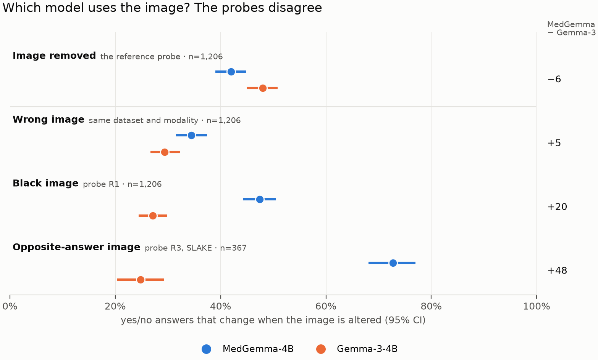
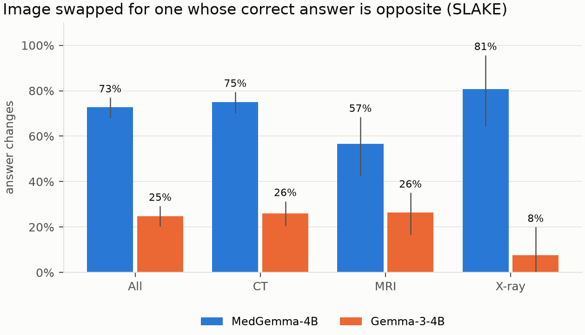
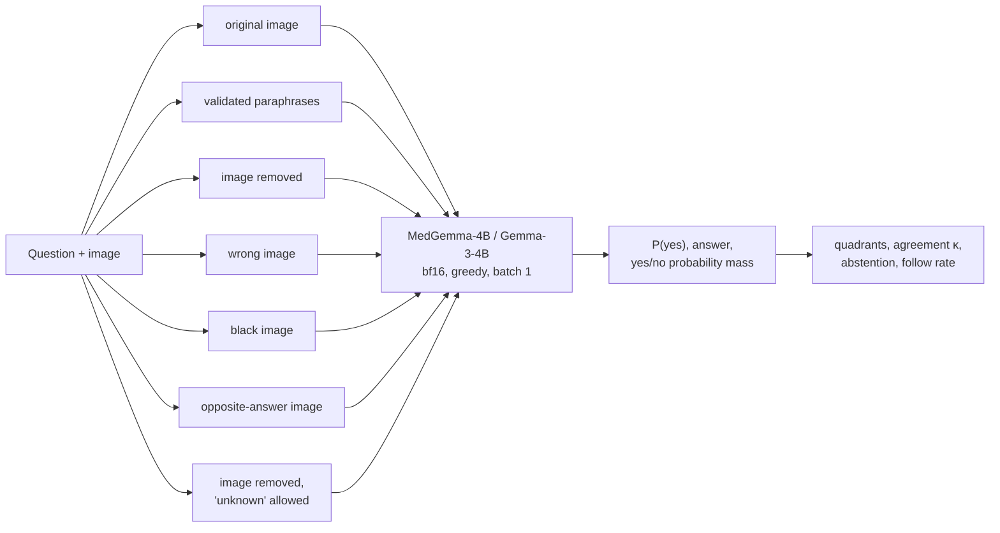

<h1 align="center">Consistent but Blind?</h1>
<p align="center"><b>Removing the image misranks how much a medical vision-language model uses it</b></p>
<p align="center">
MedGemma-4B vs Gemma-3-4B &nbsp;·&nbsp; SLAKE · VQA-RAD · PathVQA &nbsp;·&nbsp; CT · MRI · X-ray · pathology &nbsp;·&nbsp; pre-registered
</p>
<p align="center">
<a href="report/main.pdf"><b>Paper (PDF)</b></a> &nbsp;·&nbsp; <a href="RESULTS.md">All results</a> &nbsp;·&nbsp;
<a href="PLAN.md">Pre-registration &amp; lab notebook</a> &nbsp;·&nbsp; <a href="docs/REPRODUCE.md">Reproduce</a>
</p>

<p align="center"></p>

> **TL;DR.** A recent taxonomy flags a medical VLM as *consistent but dangerous* when its answer survives
> rephrasing **and** survives removing the image. We ran that test, and three tests that keep an image in the
> input, on the same questions for a medical model and its general-purpose twin. Removing the image says the
> medical model uses the image **less**. Every in-format test says it uses the image **more**, by up to 48
> points. Image removal measures whether a model will answer without an image, and whether its priors agree
> with the image, not whether it looks.

---

## The finding in one figure

<p align="center"></p>

Each row alters the image in a different way and counts how often the yes/no answer changes. A model that
uses the image should change its answer when the image changes. Only **image removal**, the probe that
defines the taxonomy, ranks Gemma-3 as the more image-reliant model (−6 points). A wrong image (+5), a black
image (+20) and an image on which the same question has the **opposite** correct answer (+48) all rank
MedGemma as more reliant. Same questions, same models, same scoring; 95% CIs clustered by image.

## Why this matters

Medical VQA benchmarks score whether an answer is right, not whether the model looked. A model can reach a
correct "yes" from language priors and be wrong on exactly the patient whose image is unusual. *Consistent but
Dangerous* ([Sadanandan & Behzadan, 2026](https://arxiv.org/abs/2603.20985)) addressed this by crossing two
per-sample tests:

|  | **Answer changes without the image** | **Answer unchanged without the image** |
|---|---|---|
| **Stable under paraphrase** | **Ideal** | **Dangerous**: trustworthy-looking, image-independent |
| **Flips under paraphrase** | **Fragile** | **Worst** |

On chest X-rays they found that fine-tuning for consistency pushes most answers into *Dangerous*. The
taxonomy is a good idea, and a natural thing to use when comparing models. This project asks whether its
reliance axis, removing the image, can be trusted to **rank** models, and finds that it can be reversed.

## What is new here, and what is not

The quadrant taxonomy, the individual probes and the observation that VLMs answer medical questions without
images all predate this project. Our contribution is to run the probes **side by side** on the same questions
and a matched model pair, and to explain why they disagree.

| | Prior work | This project |
|---|---|---|
| Quadrant taxonomy | Introduced on chest X-ray yes/no ([CbD](https://arxiv.org/abs/2603.20985)) | Reused unchanged as the reference; extended to CT, MRI and pathology on three VQA datasets |
| Black-image, swapped and hard-negative images | Used to corroborate image removal ([CbD](https://arxiv.org/abs/2603.20985)) or to define reliance metrics and train against them ([Zafar et al.](https://arxiv.org/abs/2607.03647), [Lotfinia et al.](https://arxiv.org/abs/2606.17710)) | Compared as **rankings** of two models: image removal ranks them opposite to every in-format probe |
| Refusing without an image | Studied as a safety outcome ([MedVIGIL](https://arxiv.org/abs/2605.07919), [Hearsay](https://arxiv.org/abs/2607.26886)) | Shown to be a **confound** of the image-removal probe: a forced yes/no turns refusals into scored answers |
| *Dangerous* share | Raw share; accuracy per quadrant | Chance floor and Cohen's κ; paired split into correct and wrong *Dangerous* answers |
| Medical vs general checkpoint | Model class does not predict image use ([Lotfinia et al.](https://arxiv.org/abs/2606.17710)) | An architecture-matched pair, so the comparison is not confounded by architecture or size |

## Results

*18,896 model calls per model in the main run plus 3,535 per model for the probes. Primary set: 1,206 yes/no
test questions on 670 images. All intervals are 95% cluster-bootstrap CIs by image. Every number:
[RESULTS.md](RESULTS.md).*

**1. By the reference test, MedGemma looks more "consistent but blind".** With the image removed, its
*Dangerous* share is **+13.7 points** higher than Gemma-3's [10.0, 17.5]: in every dataset and every cell of
the pre-registered sensitivity grid.

<p align="center"></p>

**2. Every probe that keeps an image in the input says the opposite** (figure above). The cleanest is the
opposite-answer image: the same question asked about another image of the same modality whose correct answer
is the opposite. MedGemma follows the image **73%** of the time, Gemma-3 **25%** (+48.0 [41.9, 53.8]), in CT,
MRI and X-ray alike. Given a black image, Gemma-3 keeps its real-image answer far more often (κ 0.33 vs
0.11), and becomes the more *Dangerous* model by 14 points.

<p align="center"></p>

**3. Why image removal gets it backwards: two confounds.**

- **Refusal.** Told to answer yes or no about an image it was not given, Gemma-3 would rather ask for the image
  on 354 of 1,206 questions (MedGemma 219). Its forced answer on those is mostly "no" and unrelated to its
  with-image answer (κ ≈ 0), so 55% of them count as "image-reliant". Allowed to say "unknown", **both models
  decline on at least 93%**.
- **Agreement between prior and image.** On questions both models answer blind, MedGemma's gap persists
  (+8.0), because its blind answers are informative (above the answer-frequency prior on PathVQA, P1a). When
  the image confirms what the prior predicts, a model that looks gives the same answer with and without it.
  The opposite-answer probe removes this case, and there MedGemma follows the image.

<p align="center"></p>

**4. What the *Dangerous* share contains.** On yes/no questions about 36–42% is a **chance floor**: answers
that would match with and without the image if the two were unrelated (Cohen's κ corrects for it; the
chance-corrected gap is Δκ = +0.11 [0.04, 0.18]). And MedGemma's excess is **entirely correct answers**:
*Dangerous*-and-correct +14.1 [11.1, 17.1], *Dangerous*-and-wrong 11.3% vs 11.7%. The residual concern is
subtler: MedGemma errs less, so more of its remaining errors (44% vs 31%) are the stable, image-independent
kind that no label-free check would catch.

<p align="center"></p>

**5. A negative result.** Image reliance, measured as image PMI of the model's own answer, does **not** flag
wrong answers (AUROC 0.51, at chance; the model's confidence reaches 0.71).

### Confirmatory tests

Endpoints P1–P3 were frozen before the main run; probe hypotheses H6–H8 after it, but before the probes were
run ([PLAN.md §15](PLAN.md)). One prediction failed and is reported as such.

| | Test | Estimate [95% CI] | Outcome |
|---|---|---|---|
| P1a | MedGemma blind accuracy − prior, PathVQA | +5.0 [0.9, 8.8], p_Holm = 0.042 | above the prior |
| P1b–c | … SLAKE, VQA-RAD | −3.1 [−7.8, 1.8]; +7.6 [0.4, 14.5], p_Holm = 0.072 | not significant |
| P2 | AUROC(image PMI) − AUROC(confidence) | −0.197 [−0.250, −0.145] | reliance is worse than confidence |
| P3 | *Dangerous* share, MedGemma − Gemma-3 (image removed) | +13.7 [10.0, 17.5], p < 0.001 | MedGemma higher |
| H6 | κ(real, black image), MedGemma − Gemma-3 > 0 | −0.22 [−0.30, −0.14], p_Holm < 0.001 | **failed, reversed** |
| H7 | Declines with "unknown" allowed, MedGemma − Gemma-3 < 0 | −6.7 [−8.2, −5.3], p_Holm < 0.001 | supported; both ≥ 93% |
| H8 | Follows an opposite-answer image, MedGemma − Gemma-3 > 0 | +48.0 [41.9, 53.8], p_Holm < 0.001 | supported |

## Method



| Probe | What changes | Role |
|---|---|---|
| **Image removed** | image tokens omitted, text identical | the taxonomy's reference probe (main run) |
| **Wrong image** | another image, same dataset and modality | second probe (main run) |
| **Black image** (R1) | a black image in the image slot | in format, no content |
| **"Unknown" allowed** (R2) | image removed, instruction allows "unknown" | separates refusal from blind answering |
| **Opposite-answer image** (R3) | another image on which the same question has the opposite gold answer | an image-reliant model must change its answer |

- **Models.** [`google/medgemma-4b-it`](https://huggingface.co/google/medgemma-4b-it) and its
  architecture-matched general twin [`google/gemma-3-4b-it`](https://huggingface.co/google/gemma-3-4b-it), both
  unquantized (bf16), because quantization would perturb the probabilities being audited. The two differ in
  their whole post-training, so we compare *checkpoints*, not "medical data" in isolation.
- **Data.** [SLAKE](https://www.med-vqa.com/slake/) (CT, MRI, X-ray; the only dataset with modality labels),
  [VQA-RAD](https://osf.io/89kps/) (radiology), [PathVQA](https://github.com/UCSD-AI4H/PathVQA) (pathology):
  3,365 questions on 907 images, sampled once with SHA-1 seeds and fixed in `manifests/main/`.
- **Scoring.** Yes/no answers from one forward pass,
  `P(yes) = sigmoid(logsumexp(yes-token logits) - logsumexp(no-token logits))`
  over token variants; the yes+no probability mass detects refusals. Open answers by
  token-F1 with an opposite-term guard (left/right, upper/lower, … never match).
- **Paraphrases.** Qwen2.5-3B-Instruct plus content-copying templates, a rule validator, and **every one of
  4,890 unique (question, paraphrase) pairs judged for equivalence** against a written rubric (1,208
  rejected, each with a reason; unjudged pairs are rejected by construction).
- **Statistics.** Cluster bootstrap over images (B = 2,000), Holm correction within families, Cohen's κ
  for chance agreement. A finding is "robust" only if its sign survives the pre-specified sensitivity grid.

## Engineering

The audit runs on one consumer GPU from a fresh clone, and every number in the paper is regenerated by a
command.

**Stack:** Python · PyTorch · Hugging Face Transformers · bf16 inference on one 16 GB GPU (RTX 4080 SUPER) ·
pandas · NumPy · scikit-learn · matplotlib · pytest · LaTeX (CVPR kit)

- **Resumable inference engine.** Each job is one (question, condition) pair keyed by ID and appended to a
  per-host JSONL log, so a crashed or interrupted run continues where it stopped, and runs split across
  machines merge. 18,896 calls per model in ~75 min (0.23 s/call, 8.2 GB peak).
- **Deterministic inputs.** Dataset loaders, seeded sampling, SHA-checked images and committed manifests: every
  run on every machine sees byte-identical prompts and images.
- **Numerical determinism.** Pre-flight showed that in bf16 the **batch size** alone shifts teacher-forced
  log-probabilities by up to 1.09 nats on identical, unpadded inputs, and an fp32 output head does not fix it.
  All runs use batch size 1; a regression check reproduces the T4 pilot on the 4080 (98.5% identical answers).
- **A paraphrase pipeline** with generation, rule validation and LLM-judged equivalence, enforced fail-closed.
- **Statistics as code.** Cluster bootstrap, Holm, κ and all post-hoc analyses in one tested module; a
  simulation test shows the clustered intervals reach nominal coverage where naive ones do not.
- **CLI and configs.** `medvlm prepare | paraphrase | pipeline | probes | analyze | compare | posthoc | regress
  | status | doctor`; configs layer base → profile → model → hardware; every command writes a timestamped log
  with progress, ETA and GPU memory.
- **97 unit tests + 7 real-model GPU tests**, including scoring edge cases, crash-safe resume, batching
  equivalence and the construction of opposite-answer partners.

## Reproduce

```bash
pip install -e ".[model,dev]" && pytest                         # 97 fast tests, no GPU needed
medvlm pipeline --profile main --model medgemma4b --hardware rtx4080 --parts 2
medvlm pipeline --profile main --model gemma3_4b  --hardware rtx4080 --parts 2
medvlm probes   --profile main --model medgemma4b --hardware rtx4080      # and gemma3_4b
medvlm posthoc  --profile main --model medgemma4b --model-b gemma3_4b     # all tables and figures
```

Full instructions, including gated-model access and pre-flight checks: [docs/REPRODUCE.md](docs/REPRODUCE.md).

## Repository

```
report/            the paper (CVPR author kit): main.tex, main.pdf, refs.bib, figures/
RESULTS.md         every result with its CI, the hypotheses, threats to validity and a post-run audit
PLAN.md            pre-registration, design decisions and lab notebook (frozen sections marked)
docs/REPRODUCE.md  how to run everything from a fresh clone
src/medvlm/        data/ (loaders, sampler), models/ (HF backend), paraphrase.py, run.py, probes.py,
                   scoring.py, analysis/ (stats, tables, post-hoc, figures), cli.py
configs/           base -> profile -> model -> hardware layering
manifests/         exact questions, image hashes, paraphrases, equivalence judgments, audit sheets
results/           analysis tables and figures per model and comparison
outputs/           raw per-call model outputs of the finished runs
tests/             fast unit tests and -m slow real-model tests
```

## Limitations

- **One model pair.** One counter-example is enough to show that image removal *can* misrank models, but not
  how often it does; more pairs are the next step.
- **Checkpoints, not causes.** MedGemma and Gemma-3 differ in their whole post-training, not only in medical
  data.
- **Probe timing.** The probes were registered after the main results were known (before running them); one of
  three predictions failed.
- **Paraphrases** were judged by an LLM and not validated by human raters. Quadrant results cover questions
  with at least two valid paraphrases (84% of the primary set).
- SLAKE is in MedGemma's training data (split unstated). PathVQA questions are auto-generated from captions.
- Benchmark VQA is not clinical use. Nothing here is a clinical claim.

## Related work

- **Consistent but Dangerous** ([arXiv 2603.20985](https://arxiv.org/abs/2603.20985)): the quadrant
  taxonomy on chest X-rays; image removal, corroborated by black-image and random-swap checks.
- **PSF-Med** ([arXiv 2602.21428](https://arxiv.org/abs/2602.21428)): paraphrase sensitivity; low flip rates
  can mean the image is ignored.
- **Do Medical VLMs Actually See?** ([arXiv 2607.03647](https://arxiv.org/abs/2607.03647)): blank, shuffled,
  absent and hard-negative images as reliance metrics and a training signal.
- **VLMs for chest radiography do not always need the image** ([arXiv 2606.17710](https://arxiv.org/abs/2606.17710)):
  image swaps and occlusion; model class does not predict image use.
- **MedVIGIL** ([arXiv 2605.07919](https://arxiv.org/abs/2605.07919)) and **Hearsay**
  ([arXiv 2607.26886](https://arxiv.org/abs/2607.26886)): whether models refuse when visual evidence is
  broken or missing.
- **How Do Medical MLLMs Fail?** ([ICLR 2026](https://arxiv.org/abs/2603.14323)): grounding measured on
  expert-annotated regions.

## Licences

SLAKE (CC-BY-4.0), VQA-RAD (CC0 1.0), PathVQA (MIT); MedGemma and Gemma-3 under Google's terms. Cite the
original dataset papers in any use of this work.
