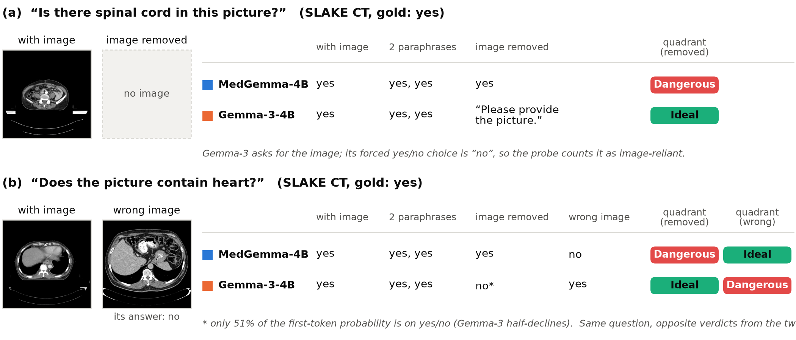
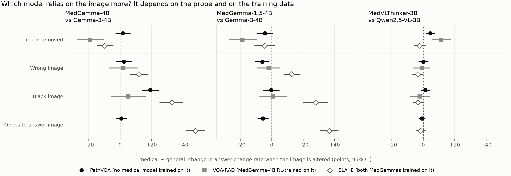
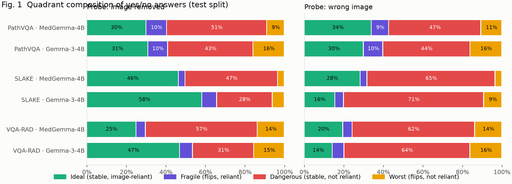
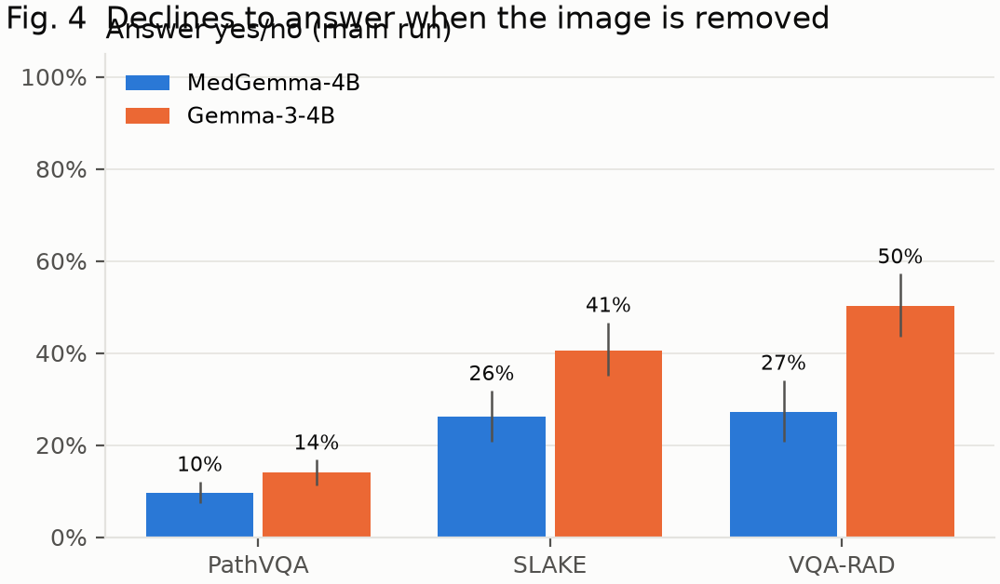
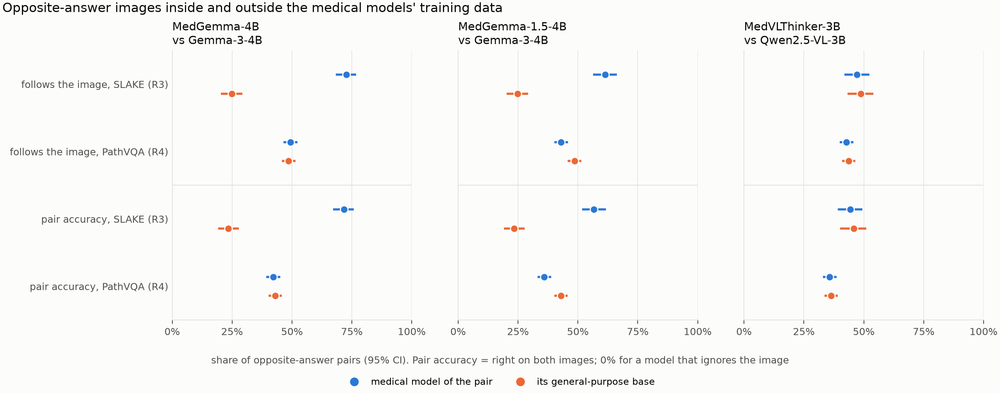
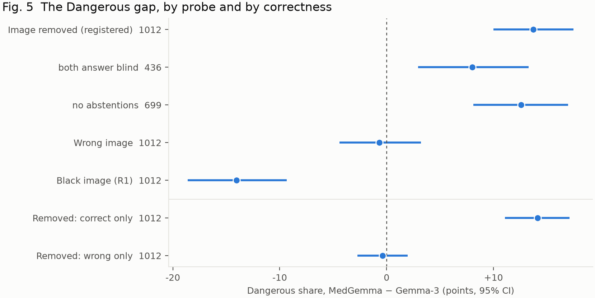
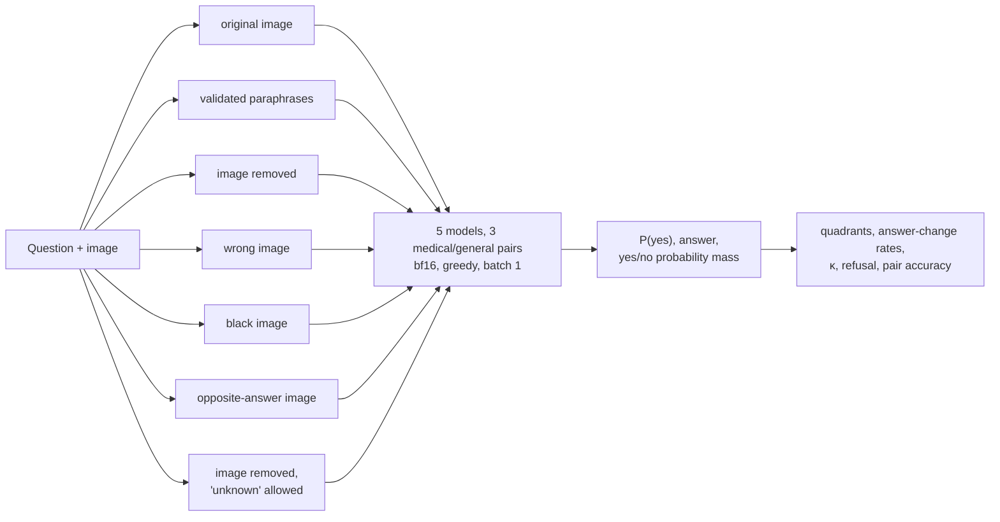

<h1 align="center">Consistent but Blind?</h1>
<p align="center"><b>Image removal does not measure image reliance in medical vision-language models</b></p>
<p align="center">
3 medical VLMs vs their general-purpose bases &nbsp;·&nbsp; SLAKE · VQA-RAD · PathVQA &nbsp;·&nbsp; CT · MRI · X-ray · pathology &nbsp;·&nbsp; pre-registered
</p>
<p align="center">
<a href="report/main.pdf"><b>Paper (PDF)</b></a> &nbsp;·&nbsp; <a href="docs/RESULTS.md">All results</a> &nbsp;·&nbsp;
<a href="docs/PREREGISTRATION.md">Pre-registration &amp; lab notebook</a> &nbsp;·&nbsp; <a href="docs/REPRODUCE.md">Reproduce</a>
</p>

<p align="center"></p>

> **TL;DR.** A recent taxonomy flags a medical VLM answer as *consistent but dangerous* when it survives
> rephrasing **and** survives removing the image. We ran that test next to three tests that keep an image in
> the input, on the same questions, for three medical VLMs and their general-purpose bases. **Image removal and
> the in-format tests never agree:** wherever image removal says a medical model ignores the image more or less
> than its base, no in-format test confirms it. What image removal picks up is whether a model refuses to answer
> without an image and whether its guesses happen to match the image. The in-format tests have their own trap:
> they show the MedGemmas using the image far more than their base only on data the MedGemmas were trained on.
> On held-out pathology data, a pre-registered test finds no difference.

---

## The finding in one figure

<p align="center"></p>

Each point is a **medical − general** difference in how often a yes/no answer changes when the image is altered.
A model that uses the image should change its answer when the image changes. Rows are probes, markers are
datasets, panels are model pairs.

- **Image removal (top row) and the in-format probes (the other rows) never agree.** Image removal separates the
  medical model from its base in 5 of 9 pair × dataset cells. In 4 of them no in-format probe sees any
  difference; in the 5th (MedGemma-4B on SLAKE) every in-format probe points the other way.
- **The in-format probes favour the MedGemmas mainly on SLAKE** (open diamonds), a dataset both were trained on.
  On PathVQA (filled circles), which no medical model was trained on, the opposite-answer gap is +0.8 for
  MedGemma-4B and −5.6 for MedGemma-1.5. That test (R4) was registered before it was run.

## Why this matters

Medical VQA benchmarks score whether an answer is right, not whether the model looked. A model can reach a
correct "yes" from language priors and be wrong on exactly the patient whose image is unusual. *Consistent but
Dangerous* ([Sadanandan & Behzadan, 2026](https://arxiv.org/abs/2603.20985)) addressed this by crossing two
per-sample tests:

|  | **Answer changes without the image** | **Answer unchanged without the image** |
|---|---|---|
| **Stable under paraphrase** | **Ideal** | **Dangerous**: trustworthy-looking, image-independent |
| **Flips under paraphrase** | **Fragile** | **Worst** |

On chest X-rays they found that fine-tuning for consistency pushes most answers into *Dangerous*. A taxonomy
like this invites model comparisons ("is the medical model more *Dangerous* than the general one?"). This
project asks whether its reliance axis, removing the image, can carry such a comparison, and finds that it
cannot.

## What is new here, and what is not

The quadrant taxonomy, the individual probes and the observation that VLMs answer medical questions without
images all predate this project. Our contribution is to run the probes **side by side** on the same questions,
for three medical/general model pairs and three datasets, **inside and outside the medical models' training
data**, and to explain why they disagree.

| | Prior work | This project |
|---|---|---|
| Quadrant taxonomy | Introduced on chest X-ray yes/no ([CbD](https://arxiv.org/abs/2603.20985)) | Reused unchanged as the reference; extended to CT, MRI and pathology on three VQA datasets |
| Black-image, swapped and hard-negative images | Used to corroborate image removal ([CbD](https://arxiv.org/abs/2603.20985)) or to define reliance metrics and train against them ([Zafar et al.](https://arxiv.org/abs/2607.03647), [Lotfinia et al.](https://arxiv.org/abs/2606.17710)) | Compared as **verdicts about the same models**: image removal is confirmed by no in-format probe, in any pair or dataset |
| Refusing without an image | Studied as a safety outcome ([MedVIGIL](https://arxiv.org/abs/2605.07919), [Hearsay](https://arxiv.org/abs/2607.26886)) | Shown to be a **confound** of the image-removal probe: a forced yes/no turns refusals into scored answers |
| Training-data exposure | Usually noted as a caveat | Tested: the same probe inside (SLAKE) and outside (PathVQA) the medical models' training data, registered in advance |
| *Dangerous* share | Raw share; accuracy per quadrant | Chance floor and Cohen's κ; paired split into correct and wrong *Dangerous* answers |

## Results

*18,896 model calls per model in the main run, 3,535 for probes R1–R3 and 2,384 for R4, five models. Primary
set: 1,206 yes/no test questions on 670 images. All intervals are 95% cluster-bootstrap CIs by image. Every
number: [docs/RESULTS.md](docs/RESULTS.md).*

**1. By the reference test, MedGemma looks more "consistent but blind".** With the image removed, MedGemma-4B's
*Dangerous* share is **+13.7 points** higher than Gemma-3's [10.0, 17.5], in every dataset and every cell of the
pre-registered sensitivity grid (MedGemma-1.5: +9.8).

<p align="center"></p>

**2. No probe that keeps an image in the input confirms it** (figure at the top). Split by dataset:

| Medical − general (points) | Dataset | Image removed | Wrong image | Black image | Opposite-answer image |
|---|---|---|---|---|---|
| MedGemma-4B − Gemma-3 | PathVQA | +1.7 | +2.3 | **+19.2** | +0.8 |
| | VQA-RAD | **−19.1** | +2.0 | +5.2 | |
| | SLAKE | **−9.9** | **+11.8** | **+33.0** | **+48.0** |
| MedGemma-1.5 − Gemma-3 | PathVQA | −4.3 | **−6.0** | −0.3 | **−5.6** |
| | VQA-RAD | **−18.7** | −2.0 | +0.8 | |
| | SLAKE | −4.5 | **+12.7** | **+27.9** | **+36.5** |
| MedVLThinker − Qwen2.5-VL | PathVQA | **+4.5** | 0.0 | +1.3 | −0.9 |
| | VQA-RAD | **+11.2** | −0.8 | −2.4 | |
| | SLAKE | −2.3 | −3.4 | **−3.4** | −1.6 |

Bold: 95% CI excludes 0. The opposite-answer image exists only where a question recurs on another image with the
opposite answer (SLAKE: R3; PathVQA: R4).

**3. What image removal picks up instead.**

- **Refusal.** Told to answer yes or no about an image it was not given, Gemma-3 would rather ask for the image
  on 354 of 1,206 questions (MedGemma-4B 219, MedGemma-1.5 8, the Qwen models never). Its forced answers there
  are mostly "no" and unrelated to its answers with the image (κ ≈ 0), so about half count as "image-reliant".
  Image removal's largest gaps sit where refusal differs most (VQA-RAD: Gemma-3 refuses on half the questions).
  Allowed to say "unknown", MedGemma-4B and Gemma-3 both decline on at least 93%.
- **Agreement between prior and image.** A model whose blind guess matches what the image shows gives the same
  answer with and without it, and image removal calls that blind. This explains the gaps in the Qwen pair, where
  nobody refuses. It also explains what MedGemma's extra *Dangerous* answers are: **all correct**
  (*Dangerous*-and-correct +14.1 [11.1, 17.1], *Dangerous*-and-wrong 11.3% vs 11.7%).

<p align="center"></p>

**4. The in-format probes depend on training data** (probe R4, registered). On SLAKE, which both MedGemma
releases were trained on, they follow an image whose correct answer is the opposite far more than Gemma-3
(72.8% vs 24.8%). On 1,192 PathVQA questions that no medical model was trained on, all five models follow the
image on 43–49% of swaps and are right on both images on 36–43% (a model that ignores the image scores 0%). The
MedGemma advantage is gone: **+0.8 [−2.7, 4.2]** for MedGemma-4B and **−5.6 [−9.1, −2.0]** for MedGemma-1.5. Under
the decision rule fixed before the run, the claim that the MedGemmas use the image more is withdrawn.

<p align="center"></p>

**5. What the *Dangerous* share contains.** On yes/no questions about 36–42% is a **chance floor**: answers that
would match with and without the image even if the two were unrelated. Cohen's κ corrects for it (the
chance-corrected gap is Δκ = +0.11 [0.04, 0.18]). The residual concern is subtle: MedGemma errs less, so more of
its remaining errors (44% vs 31%) are the stable, image-independent kind that no label-free check would catch.

<p align="center"></p>

**6. A negative result.** Image reliance, measured as image PMI of the model's own answer, does **not** flag
wrong answers (AUROC 0.51, at chance; the model's confidence reaches 0.71).

### Confirmatory tests

Endpoints P1–P3 were frozen before the main run. Every later probe and model pair was registered (a git tag)
before it was run ([docs/PREREGISTRATION.md](docs/PREREGISTRATION.md)). Failed predictions are reported as such.

| | Test | Estimate [95% CI] | Outcome |
|---|---|---|---|
| P1a | MedGemma blind accuracy − prior, PathVQA | +5.0 [0.9, 8.8], p_Holm = 0.042 | above the prior |
| P1b–c | … SLAKE, VQA-RAD | −3.1 [−7.8, 1.8]; +7.6 [0.4, 14.5], p_Holm = 0.072 | not significant |
| P2 | AUROC(image PMI) − AUROC(confidence) | −0.197 [−0.250, −0.145] | reliance is worse than confidence |
| P3 | *Dangerous* share, MedGemma − Gemma-3 (image removed) | +13.7 [10.0, 17.5], p < 0.001 | MedGemma higher |
| H6 | κ(real, black image), MedGemma − Gemma-3 > 0 | −0.22 [−0.30, −0.14] | **failed, reversed** |
| H7 | Declines with "unknown" allowed, MedGemma − Gemma-3 < 0 | −6.7 [−8.2, −5.3] | supported; both ≥ 93% |
| H8 | Follows an opposite-answer image (SLAKE), MedGemma − Gemma-3 > 0 | +48.0 [41.9, 53.8] | supported |
| H9–H11 | Added pairs: follows the SLAKE opposite image more, changes less without the image, refuses less | MedGemma-1.5: +36.5, −7.4, −28.7; MedVLThinker: −1.6, +3.9, 0.0 | MedGemma-1.5 only |
| H12a | Opposite-answer image on PathVQA, MedGemma-4B − Gemma-3 > 0 | +0.8 [−2.7, 4.2], p_Holm = 0.87 | **failed** |
| H12b | … MedGemma-1.5 − Gemma-3 > 0 | −5.6 [−9.1, −2.0], p_Holm = 0.003 | **reversed** |
| H12c | … MedVLThinker − Qwen2.5-VL within ±5 | −0.9 [−3.0, 1.3] | supported |

### What to take away

1. A *Dangerous* share measured by image removal says more about refusal policy and priors than about image use.
   Don't compare models with it.
2. Probe reliance **in format** (best: an image whose correct answer is the opposite), and run the probe on data
   **outside** each model's training set.
3. Report the *Dangerous* share with its chance floor (or as κ), and split it by correctness.
4. Let models abstain, and treat declining without an image as desirable, not as a format failure.

## Method



| Probe | What changes | Role |
|---|---|---|
| **Image removed** | image tokens omitted, text identical | the taxonomy's reference probe (main run) |
| **Wrong image** | another image, same dataset and modality | second probe (main run) |
| **Black image** (R1) | a black image in the image slot | in format, no content |
| **"Unknown" allowed** (R2) | image removed, instruction allows "unknown" | separates refusal from blind answering |
| **Opposite-answer image** (R3 SLAKE, R4 PathVQA) | another image on which the same question has the opposite gold answer | an image-reliant model must change its answer; R4 is outside every medical model's training data |

- **Models.** Three pairs, each a medical model and the general model it shares an architecture with:
  [`google/medgemma-4b-it`](https://huggingface.co/google/medgemma-4b-it) and
  [`google/medgemma-1.5-4b-it`](https://huggingface.co/google/medgemma-1.5-4b-it) vs
  [`google/gemma-3-4b-it`](https://huggingface.co/google/gemma-3-4b-it), and
  [`UCSC-VLAA/MedVLThinker-3B-RL_PMC`](https://huggingface.co/UCSC-VLAA/MedVLThinker-3B-RL_PMC) vs its base
  [`Qwen/Qwen2.5-VL-3B-Instruct`](https://huggingface.co/Qwen/Qwen2.5-VL-3B-Instruct). All run unquantized in
  bf16 with identical prompts and scoring; each added model passed a registered format check first.
- **Data.** [SLAKE](https://www.med-vqa.com/slake/) (CT, MRI, X-ray), [VQA-RAD](https://osf.io/89kps/)
  (radiology), [PathVQA](https://github.com/UCSD-AI4H/PathVQA) (pathology): 3,365 questions on 907 images,
  plus 1,192 PathVQA questions on 682 images for R4. All are sampled once with SHA-1 seeds and fixed in
  `manifests/`. What each model was trained on is documented in [docs/RESULTS.md §13](docs/RESULTS.md).
- **Scoring.** Yes/no answers come from one forward pass,
  `P(yes) = sigmoid(logsumexp(yes-token logits) - logsumexp(no-token logits))`,
  and the yes+no probability mass detects refusals. Open answers are scored by token-F1 with an opposite-term
  guard (left/right, upper/lower and similar pairs never match).
- **Paraphrases.** Generated by Qwen2.5-3B-Instruct plus content-copying templates, filtered by a rule
  validator. **Every one of the 4,890 unique (question, paraphrase) pairs was judged for equivalence** against a
  written rubric: 1,208 were rejected, each with a reason, and unjudged pairs are rejected by construction.
- **Statistics.** Cluster bootstrap over images (B = 2,000), Holm correction within families, Cohen's κ for
  chance agreement, and template-clustered sensitivity checks for the opposite-answer probes.

## Engineering

The audit runs on one consumer GPU from a fresh clone, and every number in the paper is regenerated by a
command.

**Stack:** Python · PyTorch · Hugging Face Transformers · bf16 inference on one 16 GB GPU (RTX 4080 SUPER) ·
pandas · NumPy · scikit-learn · matplotlib · pytest · LaTeX (CVPR kit)

- **Resumable inference engine.** Each job is one (question, condition) pair keyed by ID and appended to a
  per-host JSONL log, so a crashed or interrupted run continues where it stopped, and runs split across
  machines merge. About 120,000 model calls across five models; 18,896 calls per model in about 75 min
  (0.23 s/call, 8.2 GB peak).
- **Deterministic inputs.** Dataset loaders, seeded sampling, SHA-checked images and committed manifests: every
  run on every machine sees byte-identical prompts and images.
- **Numerical determinism.** Pre-flight showed that in bf16 the **batch size** alone shifts teacher-forced
  log-probabilities by up to 1.09 nats on identical, unpadded inputs, and an fp32 output head does not fix it.
  All runs use batch size 1; a regression check reproduces the T4 pilot on the 4080 (98.5% identical answers).
- **One backend, two model families.** Gemma 3 and Qwen2.5-VL run through the same Hugging Face code path, and
  the backend tests are parameterised by model (including a random-weight Qwen for CPU tests).
- **A paraphrase pipeline** with generation, rule validation and LLM-judged equivalence, enforced fail-closed.
- **Statistics as code.** Cluster bootstrap, Holm, κ and every analysis live in one tested package; a simulation
  test shows the clustered intervals reach nominal coverage where naive ones do not.
- **CLI and configs.** `medvlm prepare | paraphrase | pipeline | probes | contrast | analyze | compare | posthoc |
  replication | contamination | format-check | regress | status | doctor`. Configs layer base → profile → model
  → hardware, and every command writes a timestamped log with progress, ETA and GPU memory.
- **103 unit tests + 7 real-model GPU tests**, including scoring edge cases, crash-safe resume, batching
  equivalence, the construction of opposite-answer partners and an oracle-vs-blind check of pair accuracy.
- **Registrations are git tags** (`prereg-main`, `prereg-probes`, `prereg-replication`, `prereg-contrast`), so
  anyone can check that each plan predates its results.

## Reproduce

```bash
pip install -e ".[model,dev]" && pytest                         # 103 fast tests, no GPU needed
medvlm pipeline --profile main --model medgemma4b --hardware rtx4080 --parts 2     # each of the five models
medvlm probes   --profile main --model medgemma4b --hardware rtx4080               # each of the five models
medvlm contrast --model all --hardware rtx4080 && medvlm contrast --analyze        # probe R4
medvlm posthoc  --profile main --model medgemma4b --model-b gemma3_4b              # each pair
medvlm replication --profile main                                                  # cross-pair tables and figures
```

Full instructions, including gated-model access and pre-flight checks: [docs/REPRODUCE.md](docs/REPRODUCE.md).

## Repository

```
docs/RESULTS.md          every result with its CI, the hypotheses, threats to validity and a post-run audit
docs/PREREGISTRATION.md  the registrations (frozen sections, tagged in git), change log, errata
docs/REPRODUCE.md        how to run everything from a fresh clone
report/                  the paper (CVPR author kit): main.tex, main.pdf, refs.bib, figures/
src/medvlm/              data/ (loaders, sampler), models/ (HF backend), paraphrase.py, run.py, probes.py,
                         scoring.py, analysis/ (stats, tables, post-hoc, contrast, contamination), cli.py
configs/                 base -> profile -> model -> hardware layering
manifests/               exact questions, image hashes, paraphrases, equivalence judgments, audit sheets
results/                 analysis tables and figures (index: results/README.md)
outputs/                 raw per-call model outputs of every finished run
tests/                   fast unit tests and -m slow real-model tests
```

## Limitations

- **Three pairs, two families.** They show that image removal *can* disagree with in-format probes and suggest
  why; they do not say how often this happens across the field.
- **Post hoc parts.** The refusal and prior-agreement explanations and the per-dataset breakdown were formed after
  the primary results. Of the dataset-specific comparisons, only R4 was registered.
- **R4 is one modality.** Pathology is a domain where every model is weak (pair accuracy 36–43%). R4 argues
  against a general "the medical model uses the image more" but cannot rule out such an advantage in every
  domain.
- **Checkpoints, not causes.** Each medical model differs from its base in its whole post-training, not only in
  medical data.
- **Training exposure.** MedGemma-4B trained on SLAKE and VQA-RAD (whose test images mostly occur in its train
  split), and MedGemma-1.5 on SLAKE. The general models' training data are not published.
- **Paraphrases** were judged by an LLM and not validated by human raters. Quadrant results cover questions with
  at least two valid paraphrases (84% of the primary set).
- PathVQA questions are auto-generated from captions. Benchmark VQA is not clinical use, and nothing here is a
  clinical claim.

## Related work

- **Consistent but Dangerous** ([arXiv 2603.20985](https://arxiv.org/abs/2603.20985)): the quadrant
  taxonomy on chest X-rays; image removal, corroborated by black-image and random-swap checks.
- **PSF-Med** ([arXiv 2602.21428](https://arxiv.org/abs/2602.21428)): paraphrase sensitivity; low flip rates
  can mean the image is ignored.
- **Do Medical VLMs Actually See?** ([arXiv 2607.03647](https://arxiv.org/abs/2607.03647)): blank, shuffled,
  absent and hard-negative images as reliance metrics and a training signal.
- **VLMs for chest radiography do not always need the image** ([arXiv 2606.17710](https://arxiv.org/abs/2606.17710)):
  image swaps and occlusion; model class does not predict image use.
- **MedVIGIL** ([arXiv 2605.07919](https://arxiv.org/abs/2605.07919)) and **Hearsay**
  ([arXiv 2607.26886](https://arxiv.org/abs/2607.26886)): whether models refuse when visual evidence is
  broken or missing.
- **How Do Medical MLLMs Fail?** ([ICLR 2026](https://arxiv.org/abs/2603.14323)): grounding measured on
  expert-annotated regions.

## Licences

Code: MIT ([LICENSE](LICENSE)). Data: SLAKE (CC-BY-4.0), VQA-RAD (CC0 1.0), PathVQA (MIT). Models: MedGemma and
Gemma-3 under Google's terms, Qwen2.5-VL and MedVLThinker under their own licences. Cite the original dataset
papers in any use of this work.
