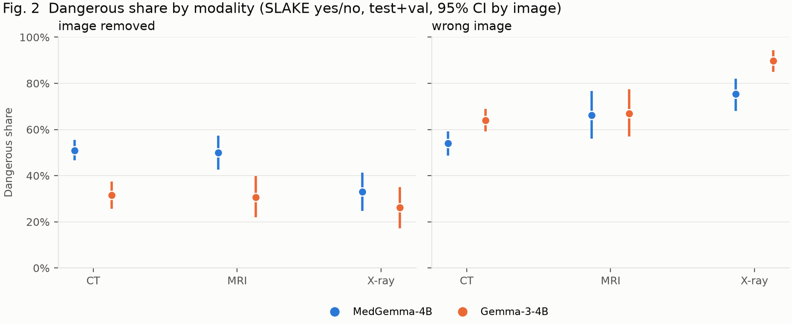
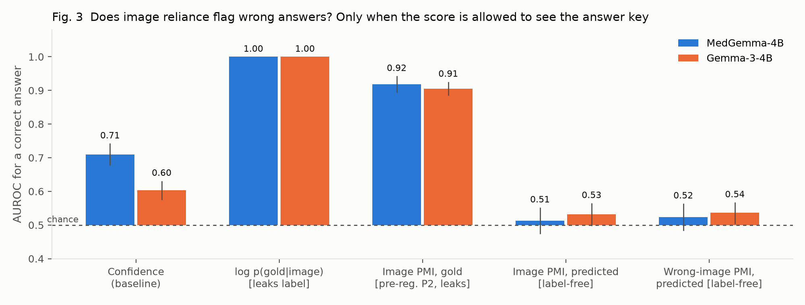

# Results: Consistent but Blind?

MedGemma-4B and its architecture-matched control Gemma-3-4B, 3,365 questions × 5.6 conditions on average =
**18,896 model calls per model**, all completed (RTX 4080 SUPER, bf16, batch 1, ~75 min per model). Primary
set: the 1,206 yes/no **test** questions on 670 images. All intervals are 95% cluster-bootstrap CIs by image
(B = 2,000). **Pre-registered** results and **post-hoc** analyses are labelled as such; every post-hoc step
and its reason is logged in [PLAN.md §13](PLAN.md) (items 12–15). Tables: `results/<model>/main/`,
`results/compare_medgemma4b_vs_gemma3_4b/main/`, `results/posthoc_medgemma4b_vs_gemma3_4b/main/`
(`medvlm analyze`, `compare`, `posthoc`).

## Summary

1. **MedGemma looks at the image and is much more accurate with it** (SLAKE yes/no 86.5% vs 68.7% for
   Gemma-3), and **when the image is swapped for one with a different correct answer, it changes its answer
   74% of the time (Gemma-3: 17%)**.
2. **Yet MedGemma is the one that is *consistent but blind* more often:** under the pre-registered
   image-removed probe its Dangerous share is **+13.7 points** higher than Gemma-3's (P3; CI [10.0, 17.5]).
   Caveat from our own audit (§9): on yes/no questions, a large part of any Dangerous share is **chance
   agreement**: MedGemma's chance floor is 41.5%, Gemma-3's 35.8%. Corrected for chance, the gap remains
   (beyond-chance agreement between with- and without-image answers, κ = 0.19 vs 0.07; Δκ = +0.11
   [0.04, 0.18]), but it is smaller than +13.7 suggests. The reason is not that MedGemma ignores images.
   **Medical tuning taught it to keep answering when the image is missing:** Gemma-3 replies "please provide the image" on 41–50% of SLAKE/VQA-RAD questions, MedGemma on
   26–27%. And MedGemma's blind answers beat the answer-frequency prior (PathVQA +5.0 points, P1).
3. **"Dangerous" is a property of the probe, not only of the model.** With a wrong image instead of no
   image, the MedGemma–Gemma gap vanishes (−0.7 points, CI [−4.4, 3.2]); the two probes agree poorly
   (κ ≤ 0.23); and the wrong-image probe is confounded wherever a different image has the same correct
   answer (all 23 chest X-ray partners checked).
4. **The pre-registered reliance score (P2) only works because it leaks the label.** Image PMI computed on
   the gold answer flags errors with AUROC 0.92. The same score on the model's own answer, which is what one
   could deploy, sits at chance (0.51), and the model's plain confidence (0.71) beats it.

## 1. Sanity checks

| | MedGemma-4B | Gemma-3-4B | Model card |
|---|---|---|---|
| SLAKE token-F1 (test, all questions) | **70.2** [67.5, 72.7] | 45.1 [42.1, 48.2] | MedGemma 72.3 · Gemma-3 40.2 |
| VQA-RAD token-F1 (test) | 64.6 [59.5, 69.4] | 45.0 [39.9, 50.3] | 49.9 · 33.6 (balanced split) |
| yes/no format mass, with image | ≥ 0.997 in every dataset | 1.000 | |

The pipeline reproduces MedGemma's published SLAKE score within 2.1 points. VQA-RAD is higher than the card,
which evaluates a harder "balanced" split. Both were anticipated in the pre-registration.

## 2. Accuracy with, without and with the wrong image (test, yes/no)

| | prior | MedGemma: image | no image | wrong image | Gemma-3: image | no image | wrong image |
|---|---|---|---|---|---|---|---|
| PathVQA | 52.2 | 65.5 | 57.2 | 51.0 | 63.2 | 53.5 | 46.7 |
| SLAKE | 50.7 | **86.5** | 47.6 | 67.0 | 68.7 | 47.6 | 62.3 |
| VQA-RAD | 53.0 | **81.3** | 60.6 | 70.5 | 56.2 | 55.4 | 60.2 |

Both models collapse toward the prior without the image on SLAKE. MedGemma keeps a margin over the prior
on PathVQA and VQA-RAD, which is the subject of Q1.

## 3. Pre-registered endpoints

| | Endpoint | MedGemma-4B | Gemma-3-4B |
|---|---|---|---|
| **P1a** | Blind accuracy − majority prior, PathVQA | **+5.0** [0.9, 8.8], p_Holm = 0.042 | +1.3 [−2.8, 5.3] |
| **P1b** | … SLAKE | −3.1 [−7.8, 1.8], p_Holm = 0.21 | −3.1 [−8.3, 2.3] |
| **P1c** | … VQA-RAD | +7.6 [0.4, 14.5], p_Holm = 0.072 | +2.4 [−4.5, 9.2] |
| **P2** | AUROC(image PMI) − AUROC(confidence) | +0.209 [0.161, 0.255], p_Holm < 0.001, **invalid, see §5** | +0.273 [0.231, 0.316], invalid |
| **P3** | Dangerous share, MedGemma − Gemma-3 (paired) | **+13.7** [10.0, 17.5], p < 0.001 (1,012 questions, 600 images) | |

**Q1 (blind accuracy above the prior).** Yes for MedGemma on PathVQA (Holm-significant); VQA-RAD is in the
same direction but not after correction; SLAKE is not. Gemma-3 is never above the prior. Post hoc, among
questions where MedGemma *does* answer without the image (format mass ≥ 0.9), the margin grows to **+11.9**
[7.1, 16.6] on PathVQA and **+15.7** [5.1, 25.3] on VQA-RAD: its blind answers are informative, i.e. it has
learned useful language priors. Memorising the test set is unlikely to be the reason: the margin appears on
PathVQA and VQA-RAD, which MedGemma's model card does not list as training data, and **not** on SLAKE, which
it does list. PathVQA questions often name the entity they ask about, which is a plausible source of prior.

## 4. Quadrants, modalities and probes (Q2)

Raw shares, as the taxonomy defines them. On yes/no questions they include chance agreement (§6, §9), so a
share near 50% is not "half the answers ignore the image".

| Dangerous share, test yes/no | PathVQA | SLAKE | VQA-RAD |
|---|---|---|---|
| MedGemma, image-removed probe | 50.6 | 46.8 | 56.5 |
| Gemma-3, image-removed probe | 43.2 | 28.1 | 31.0 |
| MedGemma, wrong-image probe | 46.6 | 64.7 | 61.9 |
| Gemma-3, wrong-image probe | 44.1 | 70.8 | 63.7 |

MedGemma is also the more **consistent** model (paraphrase flip rate 6.8% vs 13.6% on SLAKE, 19.3% vs
25.9% on PathVQA): consistency comes with medical tuning, and so does answering without the image.

**Modality** (SLAKE, test+validation pooled as pre-specified):

Under the image-removed probe MedGemma's Dangerous share is ~50% for CT (50.8 [46.6, 55.6]) and MRI
(50.0 [42.6, 57.4]) but lower for X-ray (33.1 [24.8, 41.2]). Under the wrong-image probe the order
**reverses** and X-ray becomes the most "Dangerous" (75.4%). The reversal has a mechanical explanation:
where the swapped image carries the same question we can check its gold answer, and **all 23 chest X-ray
partners had the same correct answer** (CT 58%, MRI 60%), so an unchanged answer there is correct, not
blind. On the 35 swaps whose correct answer *does* change, MedGemma changes its answer 74% of the time and
Gemma-3 17%. (Post hoc, small n: exploratory.)

**Probe agreement** (Cohen's κ between "reliant under image removal" and "reliant under wrong image",
yes/no): MedGemma 0.23 (PathVQA), −0.11 (SLAKE), 0.18 (VQA-RAD); Gemma-3 0.07, 0.03, 0.07. H5 holds: the two
probes measure different things, and a Dangerous share without its probe is underspecified.

## 5. Does image reliance flag wrong answers? (Q3) No

The pre-registered score was image PMI on the **gold** answer, log p(gold | image) − log p(gold | no image).
For yes/no, "correct" means exactly log p(gold | image) > log 0.5, so the first term is the answer key:
alone it reaches AUROC **1.000**, and the PMI inherits most of that (0.92). The flaw was in our design, and
the pilot's encouraging +0.11 was the same artefact. The deployable version uses the model's **own**
answer: label-free image PMI reaches **0.513** for MedGemma and 0.532 for Gemma-3 (chance), and
**confidence beats it by 0.197** [0.144, 0.250] (MedGemma) and 0.071 [0.025, 0.118] (Gemma-3). The wrong-image
variant is no better (0.52 / 0.54). *Whether a model leaned on the image does not tell you whether it was
right.* We also caution that gold-conditioned reliance scores look strong for reasons unrelated to reliance;
our unit tests now check this property explicitly.

## 6. Abstention and the medical-tuning effect (Q4)

The pre-registered format check (yes+no first-token mass ≥ 0.9) failed in one condition only: **image
removed** (MedGemma 37–67% of questions below 0.9, Gemma-3 18–76%; with the image ≥ 99.8%). Free generation
shows why: *"Please provide the image. I need to see the image to determine if the larynx is present."*
(Gemma-3), *"I am unable to answer this question as I do not have access to medical images."* (MedGemma).
Counting mass < 0.5 as abstaining, Gemma-3 abstains on 14 / 41 / 50% (PathVQA / SLAKE / VQA-RAD) and MedGemma
on 10 / 26 / 27%. Paired difference: **−11.2 points** [−14.0, −8.6].

P3 measures this, in part. Removing every question on which either model abstains shrinks the gap from
+13.7 to **+8.0** [2.9, 13.3] (both answer, mass ≥ 0.9; n = 436) or +12.6 [8.1, 17.0] (neither abstains,
mass ≥ 0.5; n = 699). It stays positive in every cell of the pre-registered sensitivity grid (F1 threshold ×
number of paraphrases × strong flips), and in every dataset: PathVQA +7.5 [2.6, 12.3], SLAKE +18.6
[12.2, 24.9], VQA-RAD +25.6 [14.7, 36.5]. Under the wrong-image probe it is **−0.7** [−4.4, 3.2].

**How much of the gap is chance?** "Dangerous" counts an answer as image-independent whenever the
no-image answer happens to equal the with-image answer. On yes/no questions that happens often by chance.
On the P3 set, MedGemma's answers are unchanged without the image 58.6% of the time against 49.1% expected
by chance from its yes-rates (Gemma-3: 49.7% vs 45.7%). Multiplying by each model's consistency gives a
**chance-only Dangerous floor of 41.5% (MedGemma) and 35.8% (Gemma-3)**, against observed 50.5% and 36.8%.
Gemma-3 is at its floor; MedGemma is 9 points above it. Of the +13.7-point gap, about 6 points are the
difference in floors. That difference is partly because MedGemma is **more consistent** (84.5% vs 78.4% of
questions stable under paraphrase), a desirable property the quadrant metric counts against it. The
chance-corrected effect is Δκ = +0.11 [0.04, 0.18], p = 0.002 (`results/posthoc_*/chance.csv`).

**Answer to Q4.** Medical post-training makes the model more accurate, more consistent, more willing to
answer without an image, and better than the prior when it does. That combination produces more answers
that look trustworthy and are unchanged by removing the image: the *consistent but dangerous* pattern the
chest X-ray study reported for fine-tuning, now seen on CT/MRI/X-ray (SLAKE), radiology (VQA-RAD) and
pathology (PathVQA). The wrong-image
probe shows the same model does use the image when one is present. The risk is in **missing** images, not
**ignored** ones.

## 7. Hypotheses

| | Hypothesis | Outcome |
|---|---|---|
| H1 | Blind accuracy exceeds the prior somewhere, most likely PathVQA | **Supported** for MedGemma on PathVQA (P1a); not for Gemma-3 |
| H2 | Dangerous share differs by modality | **Probe-dependent:** X-ray is lowest under image removal and highest under wrong image, explained by answer-preserving swaps |
| H3 | Image PMI flags errors better than confidence | **Not supported.** The pre-registered test was confounded by label leakage; the label-free score is at chance |
| H4 | MedGemma has a larger Dangerous share than Gemma-3 | **Supported under the pre-registered probe** (robust to the grid and to abstention), **not** under the wrong-image probe |
| H5 | The two probes agree only weakly | **Supported** (κ −0.11 to 0.23) |

## 8. Threats to validity

- Abstention is inferred from first-token probability mass, confirmed by free generation on a sample, not
  annotated for every question.
- The partner-gold analysis covers only the 112 swaps where the partner image carries the same question.
- SLAKE is in MedGemma's training data (split unstated); VQA-RAD and PathVQA are not listed. SLAKE results
  may be contaminated; the cross-dataset pattern argues against contamination driving P1.
- The Dangerous share, as defined by the reference taxonomy, is not chance-corrected (§6, §9).
- Paraphrase equivalence was judged by an LLM (PLAN.md §4.5); a 50-pair human spot-check is pending.
- Post-hoc analyses (§5 label-free PMI, §6 abstention, partner check) were motivated by the data. They
  qualify the pre-registered results and are reported as such, not as confirmatory tests.

## 9. Audit: leaks, confounds and wrong assumptions

No model is trained in this study; both are frozen and only queried. After the run we checked every path
by which the answer, or something correlated with it, could reach a model or a score, and every assumption
the conclusions rest on. Checks against the code and the committed data:

| Check | Finding | Effect on conclusions |
|---|---|---|
| Gold answer in the model input | None. The prompt is the question plus a fixed instruction; gold answers are used only *after* generation (scoring, teacher-forced log-prob in a separate forward pass) | none |
| Answer type (yes/no vs open) is derived from the gold answer and picks the instruction ("Answer with only 'yes' or 'no'") | Reveals the answer *format*, not the value. It disagrees with the question's own phrasing for 4 of 3,365 questions (0.1%, all dataset label errors such as "What do the two small hyperintensities indicate?" → "Yes") | negligible |
| Conditions differ only by the image | Verified on the rendered prompts: identical text for both models; with-image adds exactly 256 image tokens | none |
| Wrong-image partner | Never the same image, never another dataset or modality, chosen by a hash of the question ID (not by answer) | none; content confound in §4 |
| Paraphrase screening saw model outputs | No. Paraphrases were judged before the main run, from question text only | none |
| **Pre-registered P2 uses the gold answer** | **Label leak**: log p(gold \| image) alone has AUROC 1.000 | P2 not interpretable; label-free version at chance (§5) |
| **Dangerous share is not chance-corrected** | On yes/no, 49% (MedGemma) / 46% (Gemma-3) of answers would be "unchanged without the image" by chance alone | Absolute shares mostly chance; P3 survives correction at a smaller size (§6) |
| Pilot questions (design tuned on them) are part of `main` | All 330 pilot questions are in `main` (9.8%). Without them: P1 PathVQA +6.3 [2.4, 10.6], p_Holm = 0.003; P3 +12.9 [8.9, 17.1]; wrong-image P3 −0.3; label-free PMI 0.49 | none (`no_pilot.csv`) |
| Training-data contamination | Model card lists SLAKE, not VQA-RAD or PathVQA, and warns of contamination generally | SLAKE caveat; P1 pattern argues against it |
| Answer capitalisation ("Yes" vs "yes") | Scoring and the majority prior normalise case (VQA-RAD prior 133/251 = 53.0%, as reported) | none |
| Duplicate questions | 5 (image, question) pairs appear twice with conflicting gold answers (dataset noise) | negligible |
| Majority prior is computed on the test labels | Gives the strongest constant baseline, which makes P1 conservative | none |
| `compare` pooled the validation split into P3 | Bug, fixed before reporting (+14.1 → +13.7) | fixed |
