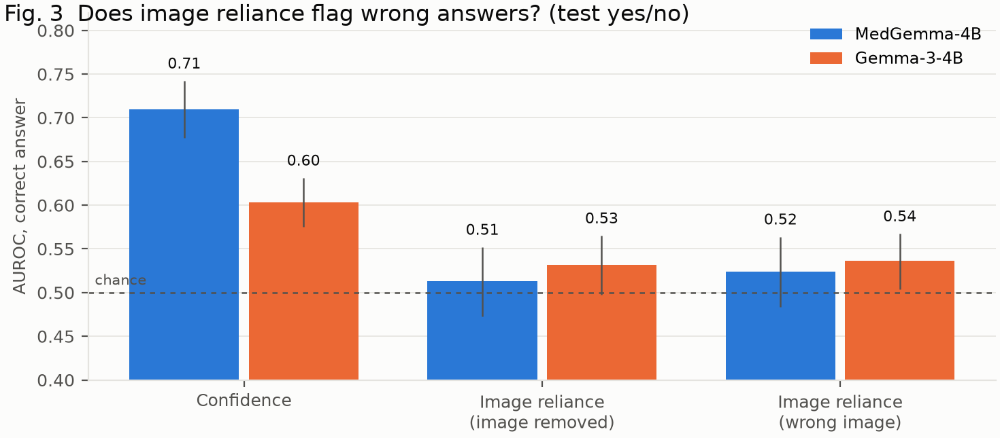

# Results: Consistent but Blind?

MedGemma-4B and its architecture-matched control Gemma-3-4B, 3,365 questions × 5.6 conditions on average =
**18,896 model calls per model**, all completed (RTX 4080 SUPER, bf16, batch 1, ~75 min per model). Primary
set: the 1,206 yes/no **test** questions on 670 images. All intervals are 95% cluster-bootstrap CIs by image
(B = 2,000). **Pre-registered** results and **post-hoc** analyses are labelled as such; every change after the
analysis plan was frozen is logged in [PLAN.md §13](PLAN.md), and the robustness probes were registered in
[PLAN.md §15](PLAN.md) before they were run. Tables: `results/<model>/main/`,
`results/compare_medgemma4b_vs_gemma3_4b/main/`, `results/posthoc_medgemma4b_vs_gemma3_4b/main/`
(`medvlm analyze`, `compare`, `posthoc`). Paper: [report/main.tex](report/main.tex).

## Summary

1. **MedGemma uses the image when one is present.** It is much more accurate with it (SLAKE yes/no 86.5% vs
   68.7% for Gemma-3), and when the image is swapped for one with a different correct answer it changes its
   answer far more often than Gemma-3 (74% vs 17% on the 35 swaps available in the main run; the registered
   opposite-answer probe tests this at scale, §7).
2. **When the image is missing, MedGemma keeps answering.** Gemma-3 replies "please provide the image" on
   41–50% of SLAKE/VQA-RAD questions, MedGemma on 26–27% (paired −11.2 points [−14.0, −8.6]), and MedGemma's
   blind answers beat the answer-frequency prior (PathVQA +5.0 points, P1a, Holm-significant).
3. **Under the reference taxonomy this makes MedGemma "consistent but dangerous" more often** (P3: +13.7
   points [10.0, 17.5]), **but the excess is entirely correct answers.** Dangerous-and-correct: +14.1
   [11.1, 17.1]; Dangerous-and-wrong (stable, image-independent and wrong, the harmful cell): 11.3% vs 11.7%,
   −0.4 [−2.7, 2.0]. Because MedGemma makes 12 points fewer errors overall, **a larger share of its remaining
   errors are of this hard-to-catch kind: 44% vs 31%** (+12.9 [6.0, 19.9]).
4. **The Dangerous share needs three corrections before it means anything:** it sits on a large chance floor
   on yes/no questions (41.5% / 35.8%; chance-corrected Δκ = +0.11 [0.04, 0.18]); it depends on the probe
   (with a wrong image instead of no image the gap is −0.7 [−4.4, 3.2]; the probes agree at κ ≤ 0.23); and it
   mixes correct and wrong answers (point 3).
5. **Image reliance does not flag wrong answers.** Label-free image PMI ranks correct above incorrect answers
   at chance (AUROC 0.51), below the model's own confidence (0.71).

## 1. Sanity checks

| | MedGemma-4B | Gemma-3-4B | Model card |
|---|---|---|---|
| SLAKE token-F1 (test, all questions) | **70.2** [67.5, 72.7] | 45.1 [42.1, 48.2] | MedGemma 72.3 · Gemma-3 40.2 |
| VQA-RAD token-F1 (test) | 64.6 [59.5, 69.4] | 45.0 [39.9, 50.3] | 49.9 · 33.6 (balanced split) |
| yes/no format mass, with image | ≥ 0.997 in every dataset | 1.000 | |

The pipeline reproduces MedGemma's published SLAKE score within 2.1 points. VQA-RAD is higher than the card,
which evaluates a harder "balanced" split. Both were anticipated in the pre-registration.

## 2. Accuracy with, without and with the wrong image (test, yes/no)

| | prior | MedGemma: image | no image | wrong image | Gemma-3: image | no image | wrong image |
|---|---|---|---|---|---|---|---|
| PathVQA | 52.2 | 65.5 | 57.2 | 51.0 | 63.2 | 53.5 | 46.7 |
| SLAKE | 50.7 | **86.5** | 47.6 | 67.0 | 68.7 | 47.6 | 62.3 |
| VQA-RAD | 53.0 | **81.3** | 60.6 | 70.5 | 56.2 | 55.4 | 60.2 |

## 3. Pre-registered endpoints

| | Endpoint | MedGemma-4B | Gemma-3-4B |
|---|---|---|---|
| **P1a** | Blind accuracy − majority prior, PathVQA | **+5.0** [0.9, 8.8], p_Holm = 0.042 | +1.3 [−2.8, 5.3] |
| **P1b** | … SLAKE | −3.1 [−7.8, 1.8], p_Holm = 0.21 | −3.1 [−8.3, 2.3] |
| **P1c** | … VQA-RAD | +7.6 [0.4, 14.5], p_Holm = 0.072 | +2.4 [−4.5, 9.2] |
| **P2** | AUROC(image PMI) − AUROC(confidence), PMI of the model's answer | **−0.197** [−0.250, −0.145] | −0.071 [−0.116, −0.026] |
| **P3** | Dangerous share, MedGemma − Gemma-3 (paired) | **+13.7** [10.0, 17.5], p < 0.001 (1,012 questions, 600 images) | |

P2 is computed on the model's own answer; the registered formula used the gold answer, which is not available
at deployment and predicts correctness by construction (PLAN.md §13, item 13).

**Q1 (blind accuracy above the prior).** Yes for MedGemma on PathVQA (Holm-significant); VQA-RAD is in the
same direction but not after correction; SLAKE is not. Gemma-3 is never above the prior. Post hoc, among
questions where MedGemma *does* answer without the image (format mass ≥ 0.9), the margin grows to **+11.9**
[7.1, 16.6] on PathVQA and **+15.7** [5.1, 25.3] on VQA-RAD: its blind answers are informative, i.e. it has
learned useful language priors. Memorising the test set is unlikely to be the reason: the margin appears on
PathVQA and VQA-RAD, which MedGemma's model card does not list as training data, and **not** on SLAKE, which
it does list.

## 4. Quadrants, modalities and probes (Q2)

Raw shares, as the taxonomy defines them. On yes/no questions they include chance agreement and correct
answers (§6), so a share near 50% is not "half the answers ignore the image".

| Dangerous share, test yes/no | PathVQA | SLAKE | VQA-RAD |
|---|---|---|---|
| MedGemma, image-removed probe | 50.6 | 46.8 | 56.5 |
| Gemma-3, image-removed probe | 43.2 | 28.1 | 31.0 |
| MedGemma, wrong-image probe | 46.6 | 64.7 | 61.9 |
| Gemma-3, wrong-image probe | 44.1 | 70.8 | 63.7 |

MedGemma is also the more **consistent** model (paraphrase flip rate 6.8% vs 13.6% on SLAKE, 19.3% vs
25.9% on PathVQA).

**Modality** (SLAKE, test+validation pooled as pre-specified):

Under the image-removed probe MedGemma's Dangerous share is ~50% for CT (50.8 [46.6, 55.6]) and MRI
(50.0 [42.6, 57.4]) but lower for X-ray (33.1 [24.8, 41.2]). Under the wrong-image probe the order
**reverses** and X-ray becomes the most "Dangerous" (75.4%). The reversal has a mechanical explanation:
where the swapped image carries the same question we can check its gold answer, and **all 23 chest X-ray
partners had the same correct answer** (CT 58%, MRI 60%), so an unchanged answer there is correct, not
blind.

**Probe agreement** (Cohen's κ between "reliant under image removal" and "reliant under wrong image",
yes/no): MedGemma 0.23 (PathVQA), −0.11 (SLAKE), 0.18 (VQA-RAD); Gemma-3 0.07, 0.03, 0.07. H5 holds: the two
probes measure different things, and a Dangerous share without its probe is underspecified.

## 5. Does image reliance flag wrong answers? (Q3) No

Each yes/no answer is scored by its image PMI, log p(answer | image) − log p(answer | no image) for the answer
the model gave: how much the image raised the probability of that answer. It ranks correct above incorrect
answers at chance (AUROC **0.513** [0.473, 0.552] for MedGemma, 0.532 for Gemma-3), while the model's own
confidence reaches 0.709 and 0.603 (**better by 0.197** [0.145, 0.250] and 0.071 [0.026, 0.116]). The
wrong-image variant is no better (0.52 / 0.54). *Whether a model leaned on the image does not tell you whether
it was right.*

## 6. What medical post-training changes (Q4)

**Abstention.** The pre-registered format check (yes+no first-token mass ≥ 0.9) failed in one condition only:
**image removed** (MedGemma 37–67% of questions below 0.9, Gemma-3 18–76%; with the image ≥ 99.8%). Free
generation shows why: *"Please provide the picture. I need to see the image to determine if there is a spinal
cord present."* (Gemma-3), *"I am unable to answer this question as I do not have access to medical images."*
(MedGemma). Counting mass < 0.5 as abstaining, Gemma-3 abstains on 14 / 41 / 50% (PathVQA / SLAKE / VQA-RAD)
and MedGemma on 10 / 26 / 27%. Paired difference: **−11.2 points** [−14.0, −8.6].

**P3.** MedGemma's Dangerous share is +13.7 points higher [10.0, 17.5], in every dataset (PathVQA +7.5
[2.6, 12.3], SLAKE +18.6 [12.2, 24.9], VQA-RAD +25.6 [14.7, 36.5]) and in every cell of the pre-registered
sensitivity grid. Removing questions on which either model abstains shrinks it to **+8.0** [2.9, 13.3] (both
answer, mass ≥ 0.9; n = 436) or +12.6 [8.1, 17.0] (neither abstains, mass ≥ 0.5; n = 699). Under the
wrong-image probe it is **−0.7** [−4.4, 3.2].

**How much of the gap is chance?** "Dangerous" counts an answer as image-independent whenever the no-image
answer happens to equal the with-image answer, which on yes/no questions happens often by chance. On the P3
set, MedGemma's answers are unchanged without the image 58.6% of the time against 49.1% expected by chance from
its yes-rates (Gemma-3: 49.7% vs 45.7%). Multiplying by each model's consistency gives a **chance-only
Dangerous floor of 41.5% (MedGemma) and 35.8% (Gemma-3)**, against observed 50.5% and 36.8%. Gemma-3 is at its
floor; MedGemma is 9 points above it. About 6 of the 13.7 points are the difference in floors, partly because
MedGemma is more consistent (84.5% vs 78.4%), a desirable property the metric counts against it. The
chance-corrected effect is Δκ = +0.11 [0.04, 0.18], p = 0.002 (`chance.csv`).

**Is Dangerous dangerous?** (post hoc, `harm.csv`) A Dangerous answer is stable and image-independent, but it
may be correct. Split by correctness:

| test yes/no, P3 set (n = 1,012) | MedGemma | Gemma-3 | Paired difference |
|---|---|---|---|
| Dangerous **and correct** | 39.2% | 25.1% | **+14.1** [11.1, 17.1] |
| Dangerous **and wrong** | 11.3% | 11.7% | −0.4 [−2.7, 2.0] |
| All errors | 25.7% | 37.6% | −12.0 [−15.5, −8.5] |
| Share of errors that are Dangerous | 43.8% | 31.0% | **+12.9** [6.0, 19.9] |

**Answer to Q4.** MedGemma's post-training makes it more accurate, more consistent, and more willing to answer
without an image, with blind answers that beat the prior and are usually right. The extra "Dangerous" answers
are these correct blind answers; the harmful cell is unchanged. The cost is subtler: MedGemma's remaining errors
look like its correct answers to every label-free check (stable, unchanged without the image, confident), so
more of them would go unnoticed. One model pair cannot separate medical data from the rest of the
post-training recipe.

## 7. Robustness probes (registered, PLAN.md §15)

*Pending: run `medvlm probes` for both models, then `medvlm posthoc`.* R1 black image (H6), R2 "unknown"
allowed (H7), R3 opposite-answer image (H8), one Holm family.

## 8. Hypotheses

| | Hypothesis | Outcome |
|---|---|---|
| H1 | Blind accuracy exceeds the prior somewhere, most likely PathVQA | **Supported** for MedGemma on PathVQA (P1a); not for Gemma-3 |
| H2 | Dangerous share differs by modality | **Probe-dependent:** X-ray is lowest under image removal and highest under wrong image, explained by answer-preserving swaps |
| H3 | Image PMI flags errors better than confidence | **Not supported:** at chance, below confidence |
| H4 | MedGemma has a larger Dangerous share than Gemma-3 | **Supported under the pre-registered probe** (robust to the grid and to abstention), **not** under the wrong-image probe; the excess is correct answers |
| H5 | The two probes agree only weakly | **Supported** (κ −0.11 to 0.23) |

## 9. Threats to validity

- One model pair; the two differ in their whole post-training, not only in medical data.
- Abstention is inferred from first-token probability mass, confirmed by free generation on a sample, not
  annotated for every question.
- SLAKE is in MedGemma's training data (split unstated); VQA-RAD and PathVQA are not listed.
- Paraphrase equivalence was judged by an LLM (PLAN.md §4.5) and not validated by human raters.
- Post-hoc analyses (chance correction, correctness split, abstention, partner check) were motivated by the data
  and are reported as such.

## 10. Audit: leaks, confounds and wrong assumptions

No model is trained in this study; both are frozen and only queried. After the run we checked every path by
which the answer, or something correlated with it, could reach a model or a score, and every assumption the
conclusions rest on:

| Check | Finding | Effect on conclusions |
|---|---|---|
| Gold answer in the model input | None. The prompt is the question plus a fixed instruction; gold answers are used only *after* generation | none |
| Answer type (yes/no vs open) is derived from the gold answer and picks the instruction | Reveals the answer *format*, not the value; disagrees with the question's phrasing for 4 of 3,365 questions (dataset label errors) | negligible |
| Conditions differ only by the image | Verified on the rendered prompts: identical text for both models; with-image adds exactly 256 image tokens | none |
| Wrong-image partner | Never the same image, never another dataset or modality, chosen by a hash of the question ID | none; content confound in §4 |
| Paraphrase screening saw model outputs | No. Judged before the main run, from question text only | none |
| P2 formula | The registered version used the gold answer (log p(gold \| image) alone has AUROC 1.0); recomputed on the model's answer from stored outputs, no rerun needed | P2 reported on the model's answer |
| Dangerous share is not chance-corrected | On yes/no, 49% / 46% of answers would be "unchanged without the image" by chance | corrected with κ (§6) |
| Dangerous mixes correct and wrong answers | 78% of MedGemma's Dangerous answers are correct | split by correctness (§6) |
| Pilot questions (design tuned on them) are part of `main` | Without them: P1 PathVQA +6.3 [2.4, 10.6], p_Holm = 0.003; P3 +12.9 [8.9, 17.1]; wrong-image P3 −0.3 | none (`no_pilot.csv`) |
| Training-data contamination | Model card lists SLAKE, not VQA-RAD or PathVQA | SLAKE caveat; P1 pattern argues against it |
| Answer capitalisation, duplicates, prior | Case normalised; 5 duplicate pairs with conflicting gold (dataset noise); the test-set prior is the strongest constant baseline | none |
| `compare` pooled the validation split into P3 | Bug, fixed before reporting (+14.1 → +13.7) | fixed |
