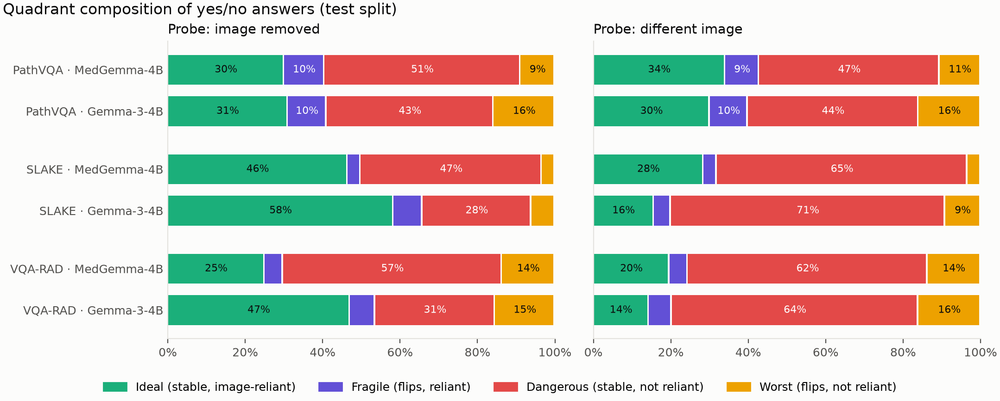
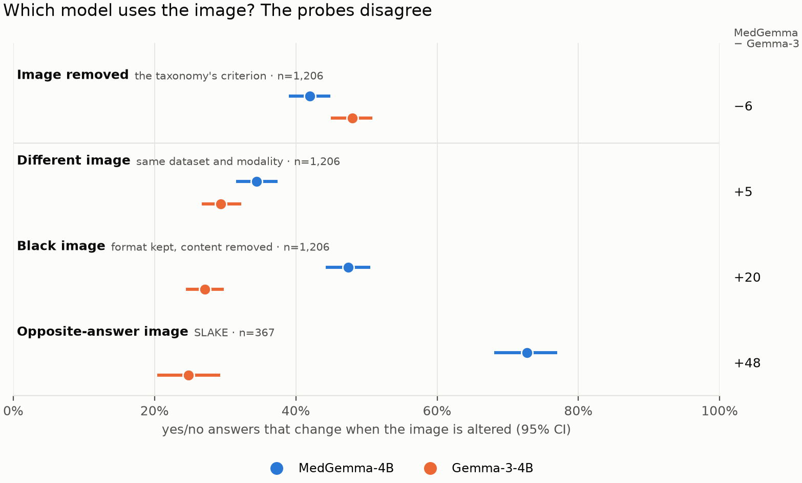
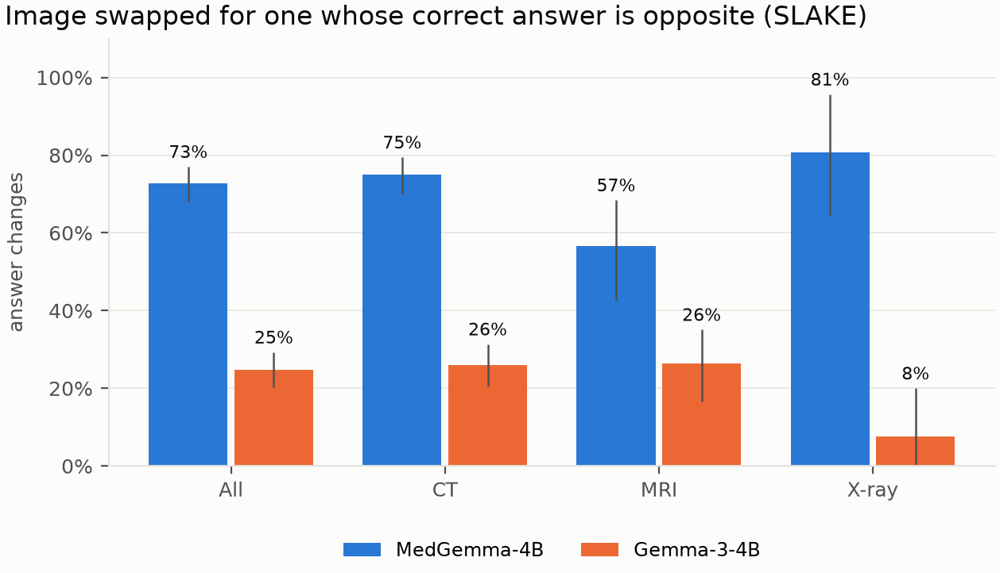
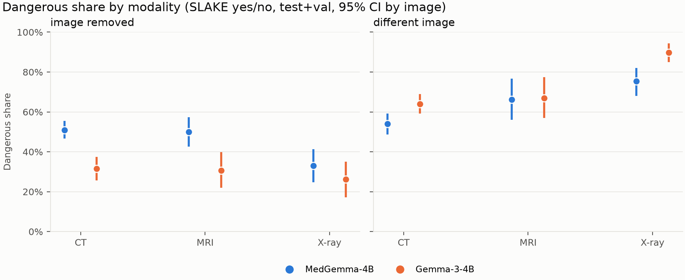
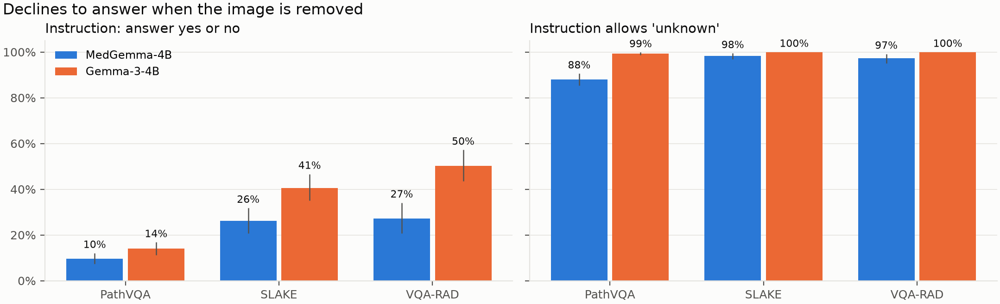
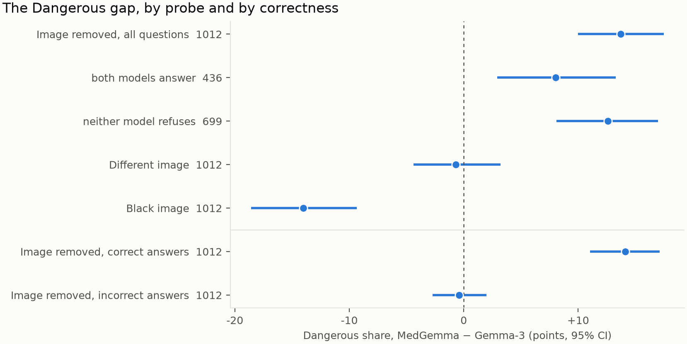
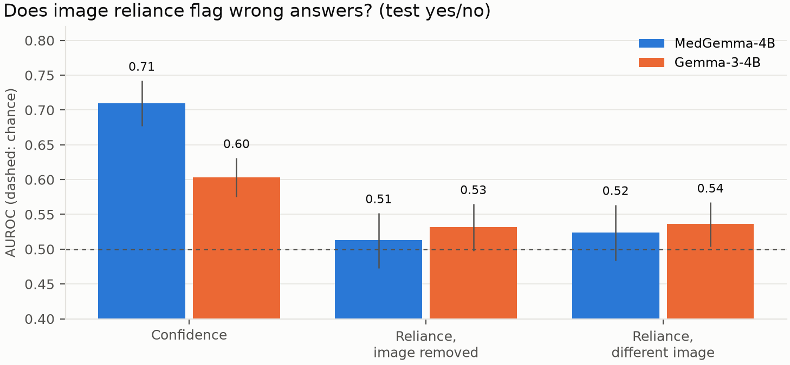
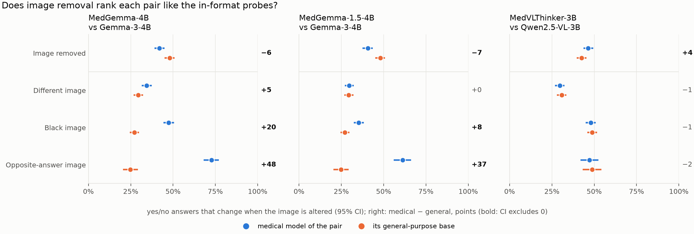
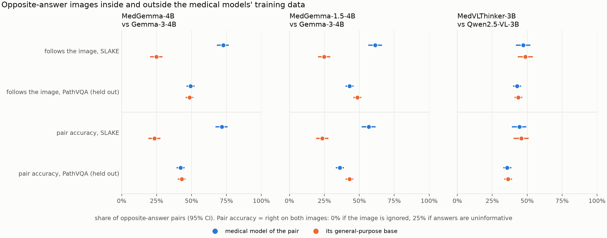
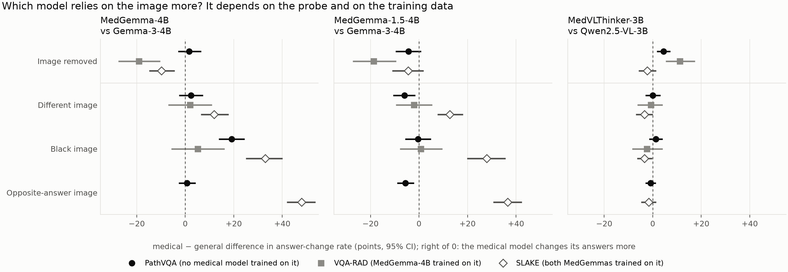

# Results: Consistent but Blind?

MedGemma-4B and its architecture-matched general-purpose twin Gemma-3-4B, plus two replication pairs (§9) and an
out-of-distribution replication of the opposite-answer probe on PathVQA (R4, §14; 1,192 questions × 2 images × 5
models), 3,365 questions × 5.6 conditions on
average = **18,896 model calls per model** in the main run, plus **3,535 per model** for the registered probes;
all completed (RTX 4080 SUPER, bf16, batch 1). Primary set: the 1,206 yes/no **test** questions on 670 images.
All intervals are 95% cluster-bootstrap CIs by image (B = 2,000). **Pre-registered** results, **registered
probes** and **post-hoc** analyses are labelled as such; every change after the analysis plan was frozen is
logged in [PREREGISTRATION.md §13 and §15–20](PREREGISTRATION.md), and the probes were registered in [PREREGISTRATION.md §15](PREREGISTRATION.md) before they were run.
Identifiers (P1–P3, H6–H12, R1–R4) are those of the pre-registration; the paper describes the same tests in words
and lists the identifiers in its Appendix D. The "different image" probe is called "wrong image" in the pre-registration and `shuf` in file names.
Tables: `results/<model>/main/`, `results/compare_medgemma4b_vs_gemma3_4b/main/`,
`results/posthoc_medgemma4b_vs_gemma3_4b/main/`, `results/contrast/`, `results/contamination/` (`medvlm analyze`,
`compare`, `posthoc`, `contrast --analyze`, `contamination`; index in [results/README.md](../results/README.md)). Paper:
[report/main.pdf](../report/main.pdf).

## Summary

1. **Image removal, the criterion of the consistent-but-dangerous taxonomy, says MedGemma ignores the image more
   than Gemma-3.** Its Dangerous share is +13.7 points higher [10.0, 17.5] (P3), in every dataset and every cell of
   the pre-registered sensitivity grid.
2. **Image removal and probes that keep an image measure different gaps** (§5, §15; post hoc). Tested directly
   as a difference of differences on the same questions, image removal and an in-format probe (different, black
   or opposite-answer image) disagree about a medical model and its base in 13 of 24 comparisons after Holm
   correction, in 6 of 9 pair × dataset cells. On SLAKE they order both MedGemma models against Gemma-3
   oppositely (reversals; 60.5 and 45.5 points apart for the opposite-answer image). On held-out PathVQA no
   disagreement with a content-based probe is shown. In-format probes also disagree with each other (5 of 21),
   never with a reversal. No probe is treated as ground truth; the opposite-answer image is the reference where it
   exists (SLAKE, PathVQA).
3. **Refusal biases image removal and accounts for part of one pair's difference** (§6; post hoc). Without an image
   Gemma-3 asks for it on 354 of 1,206 questions (MedGemma-4B 219, MedGemma-1.5 8), and its forced answers there
   are unrelated to its image answers (κ ≈ 0). Excluding refused questions removes most of the image-removal
   difference for MedGemma-1.5 (−7.4 → −2.3) but not for MedGemma-4B (−6.1 → −4.5), and the Qwen pair differs
   with no refusals.
4. **The opposite-answer probe is accuracy with the answer prior removed, and its MedGemma advantage is absent
   on held-out data** (§14). An identity ties the probe to accuracy on its balanced pairs. On SLAKE, which both
   MedGemma releases were trained on, they follow an opposite-answer image far more than Gemma-3 (+48.0, +36.5
   points). On PathVQA, which no medical model was trained on: +0.8 [−2.7, 4.2] for MedGemma-4B (H12a not
   supported) and −5.6 [−9.1, −2.0] for MedGemma-1.5 (H12b reversed under the registered analysis; weaker under
   template clustering). Under the registered decision rule the claim that the MedGemmas use the image more is
   not supported on held-out data. Exposure is one of several explanations these data cannot separate.
5. **The Dangerous share needs correcting before it means anything** (§7): a chance floor of 36–42% on yes/no
   questions (chance-corrected gap Δκ = +0.11 [0.04, 0.18]), a probe, and a correctness split read in both
   directions.
6. **Image reliance does not flag wrong answers** (§8): AUROC 0.51, below the model's confidence (0.71).

## 1. Sanity checks

| | MedGemma-4B | Gemma-3-4B | Model card |
|---|---|---|---|
| SLAKE token-F1 (test, all questions) | **70.2** [67.5, 72.7] | 45.1 [42.1, 48.2] | MedGemma 72.3 · Gemma-3 40.2 |
| VQA-RAD token-F1 (test) | 64.6 [59.5, 69.4] | 45.0 [39.9, 50.3] | 49.9 · 33.6 (balanced split) |
| yes/no format mass, with image | ≥ 0.997 in every dataset | 1.000 | |

The pipeline reproduces MedGemma's published SLAKE score within 2.1 points. VQA-RAD is higher than the card,
which evaluates a harder "balanced" split. Both were anticipated in the pre-registration.

## 2. Accuracy with, without and with a different image (test)

Yes/no accuracy (%) with the image / without it / with a different image; open answers: token-F1 ≥ 0.5 with the
image (`results/<model>/main/by_dataset_type.csv`). Majority-answer prior: PathVQA 52.2, SLAKE 50.7, VQA-RAD 53.0.

| | PathVQA yes/no | SLAKE yes/no | VQA-RAD yes/no | Open: PathVQA / SLAKE / VQA-RAD |
|---|---|---|---|---|
| MedGemma-4B | 65.5 / 57.2 / 51.0 | **86.5** / 47.6 / 67.0 | **81.3** / 60.6 / 70.5 | 10.5 / 66.7 / 46.0 |
| MedGemma-1.5-4B | 65.3 / 59.0 / 51.5 | 81.1 / 49.3 / 65.9 | 76.1 / 57.4 / 62.9 | 5.5 / 41.1 / 33.5 |
| Gemma-3-4B | 63.2 / 53.5 / 46.7 | 68.7 / 47.6 / 62.3 | 56.2 / 55.4 / 60.2 | 4.0 / 37.1 / 33.5 |
| MedVLThinker-3B | 63.7 / 57.0 / 50.0 | 78.9 / 51.3 / 68.5 | 74.9 / 62.9 / 69.7 | 4.0 / 51.6 / 39.0 |
| Qwen2.5-VL-3B | 63.0 / 55.5 / 49.0 | 76.6 / 50.1 / 65.6 | 72.9 / 62.5 / 70.9 | 3.5 / 52.4 / 37.0 |

## 3. Confirmatory tests

| | Test | Estimate [95% CI] | Outcome |
|---|---|---|---|
| | *Frozen before the main run* | | |
| **P1a** | MedGemma blind accuracy − majority prior, PathVQA | **+5.0** [0.9, 8.8] | p_Holm = 0.042 |
| **P1b** | … SLAKE | −3.1 [−7.8, 1.8] | p_Holm = 0.21 |
| **P1c** | … VQA-RAD | +7.6 [0.4, 14.5] | p_Holm = 0.072 |
| **P2** | AUROC(image PMI) − AUROC(confidence), MedGemma | **−0.197** [−0.250, −0.145] | reliance is worse |
| **P3** | Dangerous share, MedGemma − Gemma-3, image removed | **+13.7** [10.0, 17.5] | p < 0.001 (1,012 questions, 600 images) |
| | *Registered after the main run, before the probes (one Holm family)* | | |
| **H6** | κ(real, black image), MedGemma − Gemma-3 > 0 | −0.22 [−0.30, −0.14] | **failed, reversed**, p_Holm < 0.001 |
| **H7** | Declines with "unknown" allowed, MedGemma − Gemma-3 < 0 | −6.7 [−8.2, −5.3] | supported, p_Holm < 0.001 |
| **H8** | Follows an opposite-answer image, MedGemma − Gemma-3 > 0 | **+48.0** [41.9, 53.8] | supported, p_Holm < 0.001 |

Gemma-3's P1 values: +1.3 [−2.8, 5.3], −3.1 [−8.3, 2.3], +2.4 [−4.5, 9.2]; P2: −0.071 [−0.116, −0.026]. P2
is computed on the model's own answer; the registered formula used the gold answer, which is not available at
deployment and predicts correctness by construction (PREREGISTRATION.md §13, item 13).

## 4. The taxonomy's criterion: quadrants and P3

Raw shares, as the taxonomy defines them. On yes/no questions they include chance agreement (§7) and correct
answers (§6), so a share near 50% is not "half the answers ignore the image".

| Dangerous share, test yes/no | PathVQA | SLAKE | VQA-RAD |
|---|---|---|---|
| MedGemma, image-removed probe | 50.6 | 46.8 | 56.5 |
| Gemma-3, image-removed probe | 43.2 | 28.1 | 31.0 |
| MedGemma, different-image probe | 46.6 | 64.7 | 61.9 |
| Gemma-3, different-image probe | 44.1 | 70.8 | 63.7 |

**P3.** MedGemma's Dangerous share is +13.7 points higher [10.0, 17.5], in every dataset (PathVQA +7.5
[2.6, 12.3], SLAKE +18.6 [12.2, 24.9], VQA-RAD +25.6 [14.7, 36.5]) and in every cell of the pre-registered
sensitivity grid. MedGemma is also the more **consistent** model (paraphrase flip rate 6.8% vs 13.6% on SLAKE,
19.3% vs 25.9% on PathVQA). Read at face value: the medical checkpoint is more often stable, confident and
blind. The next two sections show why that reading is wrong.

## 5. Four probes, one scale (primary pair, all datasets pooled)

Share of yes/no answers that change when the image is altered (`reversal.csv`; descriptive, post hoc as a
summary of the registered probes). A model that uses the image should change its answer when the image changes.
Pooled over datasets the in-format probes rank MedGemma above Gemma-3, but §14–15 show that this comes from SLAKE,
a dataset MedGemma was trained on; on PathVQA the gaps under the content-based probes (different and
opposite-answer image) are close to 0; the black image is the exception (§15).

| Probe | n | MedGemma | Gemma-3 | MedGemma − Gemma-3 |
|---|---|---|---|---|
| Image removed (taxonomy's criterion) | 1,206 | 42.0% [39.0, 44.9] | 48.0% [45.0, 50.8] | **−6.1** [−9.5, −2.7] |
| Different image, same modality | 1,206 | 34.4% [31.6, 37.4] | 29.4% [26.7, 32.3] | **+5.1** [1.7, 8.5] |
| Black image (R1) | 1,206 | 47.4% [44.3, 50.5] | 27.1% [24.4, 29.8] | **+20.3** [15.9, 24.6] |
| Opposite-answer image (R3, SLAKE) | 367 | 72.8% [68.1, 77.0] | 24.8% [20.4, 29.3] | **+48.0** [41.9, 53.8] |

**Opposite-answer image (R3, H8 supported).** The same question, asked about another image of the same modality
whose correct answer is the opposite. MedGemma follows the image on 73% of swaps and Gemma-3 on 25%, so
MedGemma is right on the new image 86.1% of the time and Gemma-3 61.0%. The gap holds for CT (75 vs 26%), MRI
(57 vs 26%) and X-ray (81 vs 8%; exploratory), and with the 40 PathVQA/VQA-RAD swaps added (69.8 vs 24.8%,
exploratory; the registered set is SLAKE's 367 questions on 130 images).

**What following means (post hoc, `results/contrast/`).** The two gold answers of a swap are opposite, so a model
that changes its answer is either right on both images or wrong on both, and one that keeps its answer is right
on exactly one. Right on both (*pair accuracy*, the contrast-set metric) is 0 by construction for a model that
ignores the image, and 25% for a model whose answers depend on the image but carry no information. On the 367
SLAKE swaps, almost every change is a correct reading:

| SLAKE swaps (n = 367) | MedGemma-4B | MedGemma-1.5 | Gemma-3 | MedVLThinker | Qwen2.5-VL |
|---|---|---|---|---|---|
| Right on both images | **71.7%** [67.1, 75.8] | 56.7% [51.7, 61.7] | 23.4% [19.1, 27.8] | 44.4% [39.1, 49.5] | 45.8% [40.2, 51.0] |
| Wrong on both | 1.1% | 4.6% | 1.4% | 2.7% | 3.0% |
| Same answer to both | 27.2% | 38.7% | 75.2% | 52.9% | 51.2% |

Paired pair-accuracy gaps: +48.2 [42.3, 53.8] (MedGemma-4B), +33.2 [27.5, 39.2] (MedGemma-1.5), −1.4 [−4.5,
1.6] (MedVLThinker). Resampling the 53 question templates instead of images, which is more conservative because
SLAKE reuses templates across images, widens the follow-rate gaps (+48.0 [36.4, 57.7], +36.5 [23.8, 46.9]) but
leaves every conclusion unchanged.

**Black image (R1, H6 failed and reversed).** Gemma-3 keeps the answer it gave with the real image on 72.9% of
questions, MedGemma on 52.6%; chance-corrected κ 0.33 [0.28, 0.39] vs 0.11 [0.06, 0.17]. Under this probe Gemma-3
is the more Dangerous model by 14.0 points [9.4, 18.6] (44.2% vs 58.2%). The answers explain it: on a black image
MedGemma's yes-rate drops from 58% to 28% (it reads an empty image as absent findings), while Gemma-3's rises
from 64% to 84%; its answers track the question rather than the image. H6 predicted the opposite.

**Different image.** A random image of the same modality changes MedGemma's answer more often (+5.1), while the
Dangerous share under this probe does not differ (−0.7 [−4.4, 3.2]). It is the weakest probe because a random
partner often has the same correct answer: where the partner image carries the same question, **all 23 chest
X-ray partners had the same correct answer** (CT 58%, MRI 60%), so an unchanged answer there is correct, not
blind. This is why the modality ordering reverses between probes:

Under image removal MedGemma's Dangerous share is ~50% for CT (50.8 [46.6, 55.6]) and MRI (50.0 [42.6, 57.4])
and lower for X-ray (33.1 [24.8, 41.2]); under a different image X-ray becomes the most "Dangerous" (75.4%). The two
main-run probes agree poorly (κ between their reliance labels: MedGemma 0.23, −0.11, 0.18; Gemma-3 0.07, 0.03,
0.07 for PathVQA, SLAKE, VQA-RAD), so a Dangerous share without its probe is underspecified.

## 6. What image removal picks up

### Refusal

The pre-registered format check (yes+no first-token mass ≥ 0.9) failed in one condition only: **image removed**
(MedGemma 37–67% of questions below 0.9, Gemma-3 18–76%; with the image ≥ 99.8%). Free generation shows why:
*"Please provide the picture. I need to see the image to determine if there is a spinal cord present."*
(Gemma-3), *"I am unable to answer this question as I do not have access to medical images."* (MedGemma).
Counting mass < 0.5 as refusing, Gemma-3 refuses on 14 / 41 / 50% (PathVQA / SLAKE / VQA-RAD) and MedGemma on
10 / 26 / 27%; paired difference −11.2 points [−14.0, −8.6].

What a forced answer on a refused question does to the probe (`removal_split.csv`, post hoc):

| test yes/no | | n | answer changes without the image | κ(with, without image) | yes-rate without image |
|---|---|---|---|---|---|
| MedGemma | refuses (mass < 0.5) | 219 | 52.5% [45.5, 59.6] | 0.04 | 4% |
| | answers | 987 | 39.6% [36.5, 42.7] | 0.21 | 51% |
| Gemma-3 | refuses (mass < 0.5) | 354 | 55.4% [50.3, 60.7] | −0.01 | 8% |
| | answers | 852 | 45.0% [41.0, 48.8] | 0.11 | 48% |

On refused questions the forced answer is mostly "no" and unrelated to the answer with the image, so about half
of them count as "image-reliant". Gemma-3 has more of them.

**"Unknown" allowed (R2, H7 supported).** Without an image and with "unknown" allowed, MedGemma declines on 93.0%
(PathVQA 88%, SLAKE 98%, VQA-RAD 97%) and Gemma-3 on 99.7%; paired −6.7 [−8.2, −5.3]. The registered
"compliance-only" rule (gap < 3 points) is not met, so MedGemma keeps a small tendency to answer blind, mostly on
PathVQA. The gap narrows from 11.2 to 6.7 points, near the ceiling (93.0% vs 99.7%).

### Does refusal explain the difference? Only partly (post hoc)

If refusal produced the image-removal difference, the difference would vanish on questions that neither model
refuses. `results/replication_main/removal_without_refusals.csv` (added 2026-11-24, PREREGISTRATION.md §20):
medical − general difference in the share of test yes/no answers that change without the image.

| Medical − general (points) | All questions | Neither refuses (mass ≥ 0.5) | Both answer in format (mass ≥ 0.9) |
|---|---|---|---|
| MedGemma-4B − Gemma-3, pooled | −6.1 [−9.4, −2.6] (n = 1,206) | −4.5 [−8.8, 0.1] (784) | −0.6 [−5.4, 4.6] (493) |
| … PathVQA | +1.7 | +1.8 [−3.2, 7.1] (493) | +1.4 [−4.1, 7.2] (364) |
| … VQA-RAD | −19.1 | −15.5 [−29.7, −0.9] (110) | −18.3 [−33.3, −3.3] (60) |
| … SLAKE | −9.9 | −14.9 [−24.1, −5.4] (181) | +4.3 [−9.2, 16.2] (69) |
| MedGemma-1.5 − Gemma-3, pooled | −7.4 [−10.9, −3.6] | −2.3 [−7.0, 2.6] (852) | +2.3 [−3.8, 8.7] (524) |
| … PathVQA | −4.3 | −0.4 [−6.0, 5.4] (516) | −3.2 [−9.8, 3.3] (380) |
| … VQA-RAD | −18.7 | −8.0 [−20.5, 5.3] (125) | −12.5 [−29.5, 5.0] (64) |
| … SLAKE | −4.5 | −3.8 [−14.5, 7.2] (211) | **+40.0** [25.7, 52.6] (80) |
| MedVLThinker − Qwen2.5-VL, pooled | +3.9 [1.7, 6.3] | +3.9 (nobody refuses) | +4.2 [1.8, 6.7] (1,130) |

(Intervals here come from the fast cluster bootstrap and can differ in the last digit from the registered
tests.) Under the definition of refusal used everywhere else (mass < 0.5), excluding refused questions removes
most of the difference for MedGemma-1.5 and little of it for MedGemma-4B, where the SLAKE difference grows. Under
the stricter format threshold (mass ≥ 0.9, under half of the questions) the pooled differences vanish, but the
subsets are selected and unstable (MedGemma-1.5 on SLAKE: +40 on 80 questions). The Dangerous gap (P3) behaves
the same way: +12.6 [8.1, 17.0] of +13.7 without refusals and +8.0 [2.9, 13.3] at the format threshold for
MedGemma-4B; +7.5 [2.4, 12.3] of +9.8 and +3.0 [−3.6, 9.5] for MedGemma-1.5. The Qwen pair never refuses and
still differs. The mass criterion also misses a default answer: MedGemma-1.5 almost never "refuses", yet its
yes-rate falls from 47% with the image to 17% without it. **Refusal contributes, clearly for MedGemma-1.5, and
leaves most of the primary pair's difference unexplained.**

### Informative priors (a description, not an explanation)

Among the questions the models do answer, MedGemma's blind answers are informative:

- **Above the prior (P1).** MedGemma beats the majority-answer prior on PathVQA (Holm-significant); VQA-RAD is in
  the same direction but not after correction; SLAKE is not. Gemma-3 is never above the prior. Among questions
  MedGemma *does* answer without the image (mass ≥ 0.9), the margin grows to **+11.9** [7.1, 16.6] on PathVQA and
  **+15.7** [5.1, 25.3] on VQA-RAD (post hoc). Only the PathVQA margin is free of training exposure: MedGemma's
  technical report removed PathVQA from training, but it trained on VQA-RAD (RL stage), and 202 of our 203
  VQA-RAD test images also occur in VQA-RAD's train split, so the VQA-RAD margin may reflect exposure (§13;
  corrected 2026-10-16, an earlier version of this paragraph said the model card does not list VQA-RAD). SLAKE,
  also in training, shows no margin.
- **Agreement beyond chance.** On the questions each model answers, κ between its answers with and without the
  image is 0.21 for MedGemma and 0.11 for Gemma-3.

A model whose prior predicts what the image shows gives the same answer with and without it, and image removal
scores that as blind. This describes the image-removal difference; it does not explain it, because the agreement
between a model's answers with and without the image *is* what image removal measures. The correctness split
(post hoc, `harm.csv`) shows where MedGemma's excess lies. It follows in part from MedGemma's higher accuracy,
and the last row is the one that matters for risk:

| test yes/no, P3 set (n = 1,012) | MedGemma | Gemma-3 | Paired difference |
|---|---|---|---|
| Dangerous **and correct** | 39.2% | 25.1% | **+14.1** [11.1, 17.1] |
| Dangerous **and wrong** | 11.3% | 11.7% | −0.4 [−2.7, 2.0] |
| All errors | 25.7% | 37.6% | −12.0 [−15.5, −8.5] |
| Share of errors that are Dangerous | 43.8% | 31.0% | **+12.9** [6.0, 19.9] |

The opposite-answer probe (§5) removes this case by construction (the image contradicts the original answer).
**The residual concern** is subtler than "ignores the image": MedGemma errs
less, so more of its remaining errors (44% vs 31%) are stable, unchanged without the image and confident, and no
label-free check would flag them.

## 7. The chance floor

"Dangerous" counts an answer as image-independent whenever the no-image answer happens to equal the with-image
answer, which on yes/no questions happens often by chance. On the P3 set, MedGemma's answers are unchanged
without the image 58.6% of the time against 49.1% expected by chance from its yes-rates (Gemma-3: 49.7% vs
45.7%). Multiplying by each model's consistency gives a **chance-only Dangerous floor of 41.5% (MedGemma) and
35.8% (Gemma-3)**, against observed 50.5% and 36.8%. About 6 of the 13.7 points of P3 are the difference in
floors, partly because MedGemma is more consistent (84.5% vs 78.4%), a desirable property the metric counts
against it. The chance-corrected image-removal effect is Δκ = +0.112 [0.044, 0.180], p = 0.002 (`chance.csv`).

## 8. Does image reliance flag wrong answers? No

Each yes/no answer is scored by its image PMI, log p(answer | image) − log p(answer | no image) for the answer
the model gave: how much the image raised the probability of that answer. It ranks correct above incorrect
answers at chance (AUROC **0.513** [0.473, 0.552] for MedGemma, 0.532 for Gemma-3), while the model's own
confidence reaches 0.709 and 0.603 (**better by 0.197** [0.145, 0.250] and 0.071 [0.026, 0.116]). The
different-image variant is no better (0.52 / 0.54). *Whether a model leaned on the image does not tell you whether
it was right.*

## 9. Replication on two more pairs (registered, PREREGISTRATION.md §16)

Registered before any output of these models was seen: **pair A**, MedGemma-1.5-4B vs Gemma-3-4B (same family;
Gemma-3 outputs reused), and **pair B**, MedVLThinker-3B (Qwen2.5-VL-3B + RL on PMC-VQA) vs Qwen2.5-VL-3B-Instruct
(its base). Identical protocol: same questions, images, prompts, bf16, batch 1, probes and statistics. All three
new models passed the registered format check (yes/no mass with the image 0.93-0.999 on the pilot); the fallback
pair was not needed. 18,896 + 3,535 calls per model, all complete.

**Registered tests** (medical − general; one Holm family over pairs A and B; `results/replication_main.csv`):

| Pair | H9: follows opposite-answer image (> 0) | H10: answer changes without image (< 0) | H11: refuses without image (< 0) | Reversal replicates |
|---|---|---|---|---|
| Primary (reference) | +48.0 [41.9, 53.8] | −6.1 [−9.5, −2.7] | −11.2 [−14.0, −8.6] | |
| A: MedGemma-1.5 vs Gemma-3 | **+36.5** [30.6, 42.1], p_Holm < 0.001 | **−7.4** [−11.2, −3.7], p_Holm < 0.001 | **−28.7** [−31.6, −26.0], p_Holm < 0.001 | **yes** |
| B: MedVLThinker vs Qwen2.5-VL | −1.6 [−4.9, 1.4], p_Holm = 0.64 | +3.9 [1.7, 6.1] (wrong sign) | 0.0 (neither refuses) | **no** |

**All probes, all models** (share of test yes/no answers that change; `reversal.csv` per pair):

| | MedGemma-4B | MedGemma-1.5-4B | Gemma-3-4B | MedVLThinker-3B | Qwen2.5-VL-3B |
|---|---|---|---|---|---|
| Image removed | 42.0% | 40.6% | 48.0% | 46.4% | 42.5% |
| Different image | 34.4% | 29.7% | 29.4% | 29.7% | 30.8% |
| Black image | 47.4% | 35.3% | 27.1% | 47.9% | 48.8% |
| Opposite-answer image (SLAKE) | 72.8% | 61.3% | 24.8% | 47.1% | 48.8% |
| Refuses without image, forced yes/no | 18.2% | 0.7% | 29.4% | 0% | 0% |
| Declines with "unknown" allowed | 93.0% | 52.7% | 99.7% | 98.7% | 99.3% |
| Accuracy with image, SLAKE yes/no | 86.5% | 81.1% | 68.7% | 78.9% | 76.6% |

**Pair A replicates the reversal.** MedGemma-1.5 follows opposite-answer images far more than Gemma-3 and changes
more under a black image (+8.2 [3.7, 12.6]), but changes *less* when the image is removed, and its Dangerous share
under image removal is +9.8 [5.8, 13.9] higher. Refusal is even more lopsided than for MedGemma-4B (8 vs 354 of
1,206 questions), and on the 467 questions both models answer, the Dangerous gap shrinks to +3.0 [−3.6, 9.5]:
at that strict threshold refusal accounts for most of it; under the usual definition of refusal +7.5 [2.4, 12.3]
remains (§6). Unlike MedGemma-4B, MedGemma-1.5 answers blind even when allowed to decline
(it declines on 52.7%). Its excess Dangerous answers are again correct (+9.3 [5.7, 12.6] correct, +0.5 [−2.1, 3.2]
wrong).

**Pair B shows no reversal, because there is nothing to reverse.** MedVLThinker and its base are
indistinguishable under every in-format probe (opposite-answer −1.6, black −0.8 [−3.0, 1.3], different image −1.2
[−3.3, 1.0]) and in error rate (30.8% vs 31.7%): the RL fine-tune did not change how the model uses the image.
Neither model ever refuses under the forced format, and both decline on ≥ 98.7% when allowed to. Image removal
still reports a small difference the in-format probes do not see (+3.9, opposite to H10), and the base's blind
answers agree more with its image answers (κ 0.16 vs 0.09), which describes the difference rather than explains it.

**Reading.** Pooled over datasets, image removal matched the in-format probes in none of the three pairs; by
dataset the picture is finer (§15: they disagree in 6 of 9 cells). H9 (follows the
opposite-answer image more) holds for MedGemma-1.5 on SLAKE, but R4 (§14) shows that this advantage does not carry
over to PathVQA, so the pooled "reversal" is a disagreement between probes, not evidence that the MedGemmas use
the image more in general. The refusal account was formed after the primary results. §6 tests it: it explains
most of pair A's image-removal difference and little of the primary pair's.

## 10. Hypotheses

| | Hypothesis | Outcome |
|---|---|---|
| H1 | Blind accuracy exceeds the prior somewhere, most likely PathVQA | **Supported** for MedGemma on PathVQA (P1a); not for Gemma-3 |
| H2 | Dangerous share differs by modality | **Probe-dependent:** X-ray is lowest under image removal and highest under different image, explained by answer-preserving swaps |
| H3 | Image PMI flags errors better than confidence | **Not supported:** at chance, below confidence |
| H4 | MedGemma has a larger Dangerous share than Gemma-3 | **Supported only under image removal** (robust to the grid and to refusals); null under a different image, **reversed** under a black image; the excess is correct answers |
| H5 | The two main-run probes agree only weakly | **Supported** (κ −0.11 to 0.23) |
| H6 | κ(real, black image) higher for MedGemma | **Failed, reversed:** −0.22 [−0.30, −0.14] |
| H7 | With "unknown" allowed, MedGemma still declines less | **Supported**, but both decline on ≥ 93% |
| H8 | MedGemma follows opposite-answer images more often | **Supported:** +48.0 [41.9, 53.8] |
| H9 | Replication pairs: the medical model follows opposite-answer images more | **Pair A supported** (+36.5); **pair B not** (−1.6) |
| H10 | Replication pairs: image removal ranks the pair the other way | **Pair A supported** (−7.4); **pair B not** (+3.9, opposite sign) |
| H11 | Replication pairs: the general model refuses more without the image | **Pair A supported** (−28.7); **pair B not** (neither refuses) |
| H12a | R4 (PathVQA): MedGemma-4B follows opposite-answer images more than Gemma-3 | **Not supported:** +0.8 [−2.7, 4.2], p_Holm = 0.87 |
| H12b | R4: MedGemma-1.5 follows more than Gemma-3 | **Reversed:** −5.6 [−9.1, −2.0], p_Holm = 0.003 |
| H12c | R4: MedVLThinker within ±5 points of Qwen2.5-VL | **Supported:** −0.9 [−3.0, 1.3] |

## 11. Threats to validity

- Three pairs from two families: they show that image removal *can* disagree with in-format probes and that refusal
  contributes, not how often across the field. Checkpoints differ in their whole post-training, not only in medical data.
- No probe is ground truth. The reference probe (opposite-answer image) exists only on SLAKE and PathVQA; on
  VQA-RAD image removal is compared with two weaker probes, one attenuated (a random partner often has the same
  answer) and one not neutral (a black image).
- The probes were registered after the main results were known (before running them); one of three
  predictions failed. R3 is limited to SLAKE, where templated questions recur across images.
- Refusal is inferred from first-token probability mass, confirmed by free generation on a sample, not annotated
  for every question.
- Training exposure (§13–14): MedGemma-4B trained on SLAKE (its train split) and on VQA-RAD, whose test images
  mostly occur in its train split; MedGemma-1.5 lists SLAKE. The SLAKE opposite-answer gap did not replicate on
  PathVQA (R4). The general models' training data are not published.
- R4 covers one modality, pathology, on which every model is weak (pair accuracy 36–43%); the absence of a gap
  there is evidence against a general "uses the image more", not proof that no domain shows one. It also cannot
  tell equal reliance from equal difficulty: a model cannot follow an image it cannot read (§14).
- The per-dataset breakdown and the direct test of probe disagreement (§15) and the identity for the
  opposite-answer probe (§14) are post hoc; only R4 among the dataset-specific comparisons was registered.
- Paraphrase equivalence was judged by an LLM (PREREGISTRATION.md §4.5) and not validated by independent human
  raters. A second check of 50 paraphrases used in the analysis (a seeded random sample of valid paraphrases not rated in earlier rounds,
  `manifests/main/paraphrase_audit.csv`), rated by the first author with AI assistance on 2026-10-17, accepted 44 of 50
  (88%, above the pre-specified 85%; by style 78-100%). Its six rejections: a choice question turned into a yes/no
  question (T1 or T2), scanning plane to imaging orientation, liver to liver tissue, an added "clear photograph"
  qualifier, and two malformed PathVQA source questions carried through. Because AI assisted the ratings, this is a
  consistency check, not independent human validation. Only the quadrant analyses use paraphrases.
- Post-hoc analyses (chance correction, correctness split, refusal split and refusal-excluded differences,
  comparison between probes, identity for the opposite-answer probe, partner check) were motivated by the data
  and are reported as such.
- Before R4 was registered, the answers to 40 opposite-answer swaps outside SLAKE (§13) and the with-image
  answers to 108 of R4's questions had been seen.
- Holm correction is applied within each registered family, not across the study; P1a (p_Holm = 0.042) would not
  survive a correction across families. Bootstrap p-values have a resolution of 1/B (B = 2,000); a stored 0.0
  means p < 0.001.
- All disagreements between image removal and the reference probe are on SLAKE, which the MedGemma models were
  trained on. No disagreement with a content-based probe is shown on held-out data.

## 12. Audit: leaks, confounds and wrong assumptions

No model is trained in this study; all five are frozen and only queried. After the run we checked every path by
which the answer, or something correlated with it, could reach a model or a score, and every assumption the
conclusions rest on:

| Check | Finding | Effect on conclusions |
|---|---|---|
| Gold answer in the model input | None. The prompt is the question plus a fixed instruction; gold answers are used only *after* generation | none |
| Answer type (yes/no vs open) is derived from the gold answer and picks the instruction | Reveals the answer *format*, not the value; disagrees with the question's phrasing for 4 of 3,365 questions (dataset label errors) | negligible |
| Conditions differ only by the image | Verified on the rendered prompts: identical text for both models; with-image adds exactly 256 image tokens | none |
| Different-image partner | Never the same image, never another dataset or modality, chosen by a hash of the question ID | none; content confound in §5 |
| Opposite-answer partner | Same dataset, modality and normalised question; different image; opposite gold; chosen by a hash | none (unit-tested) |
| Paraphrase screening saw model outputs | No. Judged before the main run, from question text only | none |
| P2 formula | The registered version used the gold answer (log p(gold \| image) alone has AUROC 1.0); recomputed on the model's answer from stored outputs, no rerun needed | P2 reported on the model's answer |
| Dangerous share is not chance-corrected | On yes/no, 49% / 46% of answers would be "unchanged without the image" by chance | corrected with κ (§7) |
| Dangerous mixes correct and wrong answers | 78% of MedGemma's Dangerous answers are correct | split by correctness (§6) |
| Pilot questions (design tuned on them) are part of `main` | Without them: P1 PathVQA +6.3 [2.4, 10.6], p_Holm = 0.003; P3 +12.9 [8.9, 17.1]; different-image P3 −0.3 | none (`no_pilot.csv`) |
| Training-data contamination | MedGemma-4B: SLAKE (train split) and VQA-RAD (RL) per its technical report; PathVQA removed. 202/203 VQA-RAD test images are also VQA-RAD train images (`results/contamination/`) | P1c (VQA-RAD) may reflect exposure; R3 is on a trained-on distribution, so R4 was registered (§13). Corrected 2026-10-16 |
| Answer capitalisation, duplicates, prior | Case normalised; 5 duplicate pairs with conflicting gold (dataset noise); the test-set prior is the strongest constant baseline | none |
| `compare` pooled the validation split into P3 | Bug, fixed before reporting (+14.1 → +13.7) | fixed |

## 13. Training data, and whether the opposite-answer result is a SLAKE effect

Added 2026-10-16 after re-checking every model's training documentation (`medvlm contamination`;
`results/contamination/`). The check corrected two statements made earlier (PREREGISTRATION.md §18).

**What each model was trained on, by its own documentation.**

| | SLAKE | VQA-RAD | PathVQA |
|---|---|---|---|
| MedGemma-4B (technical report, Table 1) | trained: 450 items = SLAKE's train images | trained: 1,391 QA, RL stage | **removed from training** |
| MedGemma-1.5-4B (model card) | trained | not stated (data ownership only) | not mentioned |
| MedVLThinker-3B (model card) | not mentioned (RL on PMC-VQA) | not mentioned | not mentioned |
| Gemma-3-4B, Qwen2.5-VL-3B | unknown | unknown | unknown |

**Which evaluated images occur in the dataset's own train split.**

| Evaluated set | Questions | Images | Images also in the train split |
|---|---|---|---|
| SLAKE test / validation | 1,061 / 1,053 | 96 / 96 | 0 / 0 |
| VQA-RAD test | 451 | 203 | **202** (250 of 251 yes/no questions) |
| PathVQA test (main) | 800 | 512 | 0 |
| PathVQA test + validation (R4) | 1,192 | 682 | 0 |

**Consequences.** (1) The VQA-RAD results of MedGemma-4B, including its blind-answer margin (P1c), may reflect
training exposure to the same images. (2) The SLAKE images used by R3 were not training images (if MedGemma used
SLAKE's train split, as the count suggests), but their distribution and question templates were. Both MedGemma
releases trained on SLAKE and both follow opposite-answer images far more than Gemma-3; MedVLThinker did not
train on it and does not. "Trained on SLAKE" therefore explains R3 as well as "uses the image more" does.

**Probe R4 (registered before running, PREREGISTRATION.md §17; outcome in §14).** The opposite-answer probe repeated on PathVQA,
outside every medical model's listed training data: all 1,192 test + validation yes/no questions that also occur
on a different image with the opposite answer, on 682 images (none in PathVQA's train split). Hypotheses H12a-b:
both MedGemma releases follow more than Gemma-3; H12c: MedVLThinker within ±5 points of its base. If H12a-b hold,
the claim that MedGemma uses the image more stands on data it was not trained on; if not, it is restricted to the
disagreement between probes on the same questions. Run with `medvlm contrast --model all --hardware rtx4080`
(about an hour for five models), then `medvlm contrast --analyze`. A first look at the 40 non-SLAKE swaps
already in the main run (exploratory, seen before registering): MedGemma-4B − Gemma-3 +17.5 [0.0, 34.1],
MedGemma-1.5 +12.5 [−5.1, 32.5], MedVLThinker 0.0 [−16.7, 17.1]: the same direction as on SLAKE, smaller, too
few to decide.

## 14. Probe R4: opposite-answer images outside the training data (registered, PREREGISTRATION.md §17)

Run 2026-10-17 for all five models: each of the 1,192 PathVQA test + validation yes/no questions on its own image
and on a different image with the opposite gold answer (682 images, none in PathVQA's train split, none listed as
training data of any medical model). Same prompt, bf16, batch 1, greedy. `results/contrast/`.

| PathVQA, n = 1,192 | MedGemma-4B | MedGemma-1.5 | Gemma-3 | MedVLThinker | Qwen2.5-VL |
|---|---|---|---|---|---|
| Follows the image (answer changes) | 49.3% [46.4, 52.2] | 43.0% [40.1, 45.8] | 48.6% [45.8, 51.4] | 42.7% [39.9, 45.7] | 43.6% [40.9, 46.5] |
| Right on both images (pair accuracy) | 42.2% | 36.0% | 43.0% | 35.7% | 36.3% |
| Wrong on both | 7.1% | 7.0% | 5.6% | 7.0% | 7.3% |
| Accuracy, own image / partner image | 66.4 / 68.7% | 66.4 / 62.6% | 66.4 / 71.0% | 57.5 / 71.1% | 59.2 / 69.8% |

**Registered tests** (medical − general follow rate, one Holm family):

| | Pair | Predicted | Estimate [95% CI] | p_Holm | Outcome |
|---|---|---|---|---|---|
| H12a | MedGemma-4B − Gemma-3 | > 0 | +0.8 [−2.7, 4.2] | 0.87 | **not supported** |
| H12b | MedGemma-1.5 − Gemma-3 | > 0 | **−5.6** [−9.1, −2.0] | 0.003 | **reversed** |
| H12c | MedVLThinker − Qwen2.5-VL | within ±5 | −0.9 [−3.0, 1.3] | | **supported** |

Resampling PathVQA's 154 question templates instead of images (more conservative) gives +0.8 [−6.8, 7.3], −5.6
[−12.0, −0.2] and −0.9 [−5.3, 2.9]. Two registered outcomes weaken (see "Sensitivity to clustering" below); the
conclusion that neither MedGemma model follows the image more than Gemma-3 does not.

**Decision rule** (fixed before running): H12a fails with a CI that includes 0, so the SLAKE gap (+48.0) is
reported as possibly a training-distribution effect and the claim is restricted to the disagreement between
probes on the same questions (rule ii). H12b is below 0, so the claim that MedGemma-1.5 uses the image more is
withdrawn (rule iii). The Qwen pair behaves as predicted.

**Reading.** Every model follows the PathVQA partner image on 43–49% of swaps and is right on both images on
36–43%, above the 0% of a model that ignores the image and the 25% of image-dependent guessing: all five read
pathology images, to a similar and modest degree. MedGemma's large SLAKE advantage (pair accuracy 71.7% vs
23.4%) does not appear on PathVQA, which it was not
trained on. This matches accuracy: with the image, MedGemma-4B
beats Gemma-3 by 18 points on SLAKE yes/no and by 2 on PathVQA (§2).

**Sensitivity to clustering.** The 1,192 questions reuse 154 question templates and draw their partners from
only 508 questions on 397 images, so the pairs are far from independent. Under template clustering H12b's
interval is [−12.0, −0.2] (p = 0.047, not significant after Holm) and H12c's is [−5.3, 2.9] (slightly outside the
±5 margin). The registered outcomes above use the registered bootstrap over images; the conclusion common to both
analyses is that neither MedGemma model follows the image more than Gemma-3 on PathVQA.

**Floor.** PathVQA is hard for every model. In this set the own-image gold answer is "yes" for 65.0% of
questions, and the Gemma-family models are 66.4% accurate on the own image (the Qwen pair 57.5% and 59.2%). A
model cannot follow an image it cannot read, so "no difference" may reflect equal difficulty as much as equal
reliance. SLAKE and PathVQA also differ in modality and label quality as well as in training exposure.

### The opposite-answer probe is accuracy with the answer prior removed (post hoc)

Added 2026-11-24 (`results/contrast/contrast_models.csv`, column `accuracy_pairs`; PREREGISTRATION.md §20). With
*a* and *b* the accuracies on the own and the partner image and *w* the share of pairs answered wrongly on both,
the opposite gold answers force

    pair accuracy = a + b − 1 + w          follow rate = a + b − 1 + 2w

exactly (checked to machine precision in every run, and unit-tested). On these pairs the answers are balanced by
construction, so a model that ignores the image is right on exactly half of the images; the follow rate is its
accuracy above 50%, doubled, plus 2w.

| | Accuracy over both images [95% CI] | Follows the image | Pair accuracy | Wrong on both (w) |
|---|---|---|---|---|
| **SLAKE, n = 367** (training data of both MedGemmas) | | | | |
| MedGemma-4B | 85.3% [82.9, 87.5] | 72.8% | 71.7% | 1.1% |
| MedGemma-1.5 | 76.0% [73.1, 79.0] | 61.3% | 56.7% | 4.6% |
| Gemma-3 | 61.0% [58.8, 63.2] | 24.8% | 23.4% | 1.4% |
| MedVLThinker | 70.8% [67.8, 73.6] | 47.1% | 44.4% | 2.7% |
| Qwen2.5-VL | 71.4% [68.3, 74.3] | 48.8% | 45.8% | 3.0% |
| **PathVQA, n = 1,192** (held out) | | | | |
| MedGemma-4B | 67.5% [65.7, 69.4] | 49.3% | 42.2% | 7.1% |
| MedGemma-1.5 | 64.5% [62.7, 66.3] | 43.0% | 36.0% | 7.0% |
| Gemma-3 | 68.7% [66.9, 70.4] | 48.6% | 43.0% | 5.6% |
| MedVLThinker | 64.3% [62.6, 66.1] | 42.7% | 35.7% | 7.0% |
| Qwen2.5-VL | 64.5% [62.8, 66.3] | 43.6% | 36.3% | 7.3% |

**What this means.** The probe does not measure a property separate from accuracy: it measures accuracy on a
set from which the answer prior has been removed. That is why it is the better probe (ordinary accuracy can be
earned from priors; this cannot), and why it inherits whatever makes a model accurate on a dataset, including
having been trained on it. On SLAKE Gemma-3 is 11 points above what ignoring the image yields and MedGemma-4B 35
points; on PathVQA all five models are 14–19 points above it.

*Correction.* A version of this section dated 2026-11-24 compared pair accuracy with the product of the two
single-image accuracies and called Gemma-3 on SLAKE an informative exception. By the identity that comparison is
mechanical (pair − a·b = w − (1 − a)(1 − b)), so the "exception" only restated Gemma-3's lower accuracy. It has
been removed (PREREGISTRATION.md §20).

## 15. Every probe, by dataset (post hoc)

Medical − general difference in the share of yes/no answers that change, per probe, dataset and pair
(`results/replication_main/by_dataset.csv`; test split; opposite-answer image: R3 on SLAKE, R4 on PathVQA; 95%
CIs by image).

| Pair | Dataset | Image removed | Different image | Black image | Opposite-answer | Refusal gap |
|---|---|---|---|---|---|---|
| MedGemma-4B − Gemma-3 | PathVQA | +1.7 [−3.0, 6.6] | +2.3 [−2.6, 7.4] | **+19.2** [13.8, 24.5] | +0.8 [−2.7, 4.2] | −4.3 |
| | VQA-RAD | **−19.1** [−27.6, −10.4] | +2.0 [−7.0, 10.9] | +5.2 [−5.8, 16.2] | | −23.1 |
| | SLAKE | **−9.9** [−14.9, −4.4] | **+11.8** [6.4, 17.8] | **+33.0** [24.9, 40.1] | **+48.0** [41.9, 53.7] | −14.4 |
| MedGemma-1.5 − Gemma-3 | PathVQA | −4.3 [−9.6, 0.8] | **−6.0** [−10.7, −1.5] | −0.3 [−5.7, 4.9] | **−5.6** [−9.1, −2.0] | −13.7 |
| | VQA-RAD | **−18.7** [−27.3, −9.4] | −2.0 [−9.5, 5.4] | +0.8 [−7.9, 9.7] | | −47.8 |
| | SLAKE | −4.5 [−11.1, 1.9] | **+12.7** [7.6, 18.1] | **+27.9** [19.8, 35.7] | **+36.5** [30.6, 42.5] | −40.6 |
| MedVLThinker − Qwen2.5-VL | PathVQA | **+4.5** [1.7, 7.2] | 0.0 [−3.0, 3.2] | +1.3 [−1.5, 4.0] | −0.9 [−3.0, 1.3] | 0 |
| | VQA-RAD | **+11.2** [5.3, 17.4] | −0.8 [−6.3, 4.1] | −2.4 [−8.4, 4.1] | | 0 |
| | SLAKE | −2.3 [−5.9, 1.4] | −3.4 [−6.9, 0.0] | **−3.4** [−6.5, −0.3] | −1.6 [−4.9, 1.4] | 0 |

**Reading the table by significance.** Image removal separates the two models in five cells (bold in the first
column). In four of them no in-format probe finds any difference; in the fifth (MedGemma-4B on SLAKE) every
in-format probe points the other way. Its three negative cells are cells where the general model refuses far more
(VQA-RAD: 23 and 48 points); its two positive cells are in the Qwen pair, where neither model ever refuses and the
difference comes from how well each model's blind guesses match its image answers. But "significant under one
probe and not under another" is not by itself evidence that two probes disagree, and one cell reads the other
way: for MedGemma-1.5 on PathVQA image removal (−4.3), a different image (−6.0) and the opposite-answer image (−5.6,
on the R4 question set) agree in direction. The next table tests the disagreement itself.

### Do two probes report the same difference? A direct test (post hoc)

`results/replication_main/probe_disagreement.csv`, written by `medvlm replication` (PREREGISTRATION.md §19–20).
For each pair, dataset and two probes: the medical − general difference under the first probe **minus** the same
difference under the second, on the same questions, with a 95% CI from the bootstrap over images. Zero means the
two probes report the same difference. A non-zero value does not by itself mean that they order the models
differently, since probes differ in base rate and ceiling; a **reversal** (⇄) is the stricter case in which each
probe's own difference excludes 0 and the two have opposite signs. Holm correction is within two families: image
removal against an in-format probe (24 rows) and one in-format probe against another (21 rows). Different and
black image: test yes/no questions. Opposite-answer image: the questions with a partner image and every
condition, 367 on SLAKE (image-removal difference on that set: −12.5 [−18.4, −6.5], −9.0 [−16.6, −1.6], 0.0) and
the 108 PathVQA test questions of R4 that are also in the main run; VQA-RAD has none.

| Image removal − in-format probe | Dataset | Different image | Black image | Opposite-answer image |
|---|---|---|---|---|
| MedGemma-4B − Gemma-3 | PathVQA | −0.7 [−7.1, 5.9] | **−17.5** [−23.8, −10.8] | −5.6 [−22.6, 10.9] |
| | VQA-RAD | **−21.1** [−32.2, −9.6] | **−24.3** [−36.3, −11.7] | |
| | SLAKE | **−21.7** [−30.5, −13.3] ⇄ | **−42.8** [−52.1, −33.0] ⇄ | **−60.5** [−68.8, −51.3] ⇄ |
| MedGemma-1.5 − Gemma-3 | PathVQA | +1.7 [−4.8, 8.0] | −4.0 [−9.5, 1.7] | +3.7 [−14.2, 21.4] |
| | VQA-RAD | **−16.7** [−26.0, −6.7] | **−19.5** [−29.6, −9.2] | |
| | SLAKE | **−17.2** [−26.2, −8.7] | **−32.4** [−41.8, −23.0] | **−45.5** [−56.5, −34.0] ⇄ |
| MedVLThinker − Qwen2.5-VL | PathVQA | +4.5 [0.5, 8.5] (p_Holm = 0.34) | +3.2 [0.0, 6.4] | +0.9 [−9.2, 11.7] |
| | VQA-RAD | **+12.0** [4.3, 20.0] | **+13.5** [6.1, 21.5] | |
| | SLAKE | +1.1 [−4.0, 6.7] | +1.1 [−2.0, 4.7] | +1.6 [−2.1, 5.5] |

Bold: p_Holm < 0.05. **Image removal and an in-format probe measure a different gap in 13 of 24
comparisons, covering 6 of 9 cells** (5 of 9 without the black image, which separates MedGemma-4B from Gemma-3
on PathVQA for a reason unrelated to image content).

- **Reversals occur on SLAKE only**: for MedGemma-4B against every in-format probe, and for MedGemma-1.5 against
  the opposite-answer image.
- **On VQA-RAD only image removal reports a difference**, and all six comparisons are significant. There is no
  opposite-answer probe there, so the comparison is with the two weaker probes, on images MedGemma-4B was
  trained on.
- **On held-out PathVQA no disagreement with a content-based probe is shown**, for any pair. The intervals (±4–7
  points against the different image, ±10–18 against the opposite-answer image on 108 questions) are too wide to
  call this agreement. The same holds for the Qwen pair on SLAKE.
- Six of the nine cells share the same Gemma-3 outputs, so they are not independent replications.

**Between in-format probes** (same test, second family): 5 of 21 comparisons differ, none is a reversal.

| In-format probe pair | Significant differences (p_Holm < 0.05) |
|---|---|
| Different − black image | MedGemma-4B PathVQA −16.8 [−23.6, −9.9]; MedGemma-4B SLAKE −21.1 [−30.1, −12.1]; MedGemma-1.5 SLAKE −15.2 [−22.9, −7.0] |
| Different − opposite-answer image | MedGemma-4B SLAKE −28.1 [−35.5, −20.7]; MedGemma-1.5 SLAKE −17.7 [−25.7, −10.0] |
| Black − opposite-answer image | none (MedGemma-4B SLAKE −13.1 [−21.8, −4.0], p_Holm = 0.14) |

So the different-image probe reports a smaller MedGemma advantage on SLAKE than the two stronger probes, in line
with its attenuation by partners that have the same answer. Probes are not interchangeable in general; image
removal is the only one that reverses an order.

**The in-format advantage of the MedGemmas appears on SLAKE only.** Different, black and opposite-answer images all
separate the MedGemmas from Gemma-3 on SLAKE, their training distribution, and almost nowhere else. The one
exception is MedGemma-4B on a black image, which changes its answer more on every dataset (+19 on PathVQA): it reads
an empty image as "no findings" (its yes-rate falls from 58% to 28%), a reaction to the image slot rather than use
of image content, since its content probes (different and opposite-answer image) show no PathVQA difference.

*Intervals.* The per-dataset table above comes from `by_dataset.csv`; the registered tests H8 and H9 report the
same SLAKE differences with intervals [41.9, 53.8] and [30.6, 42.1] from their own bootstrap runs, and the
paper's Table 3 takes the image-removal intervals from `probe_disagreement.csv`. Intervals for one quantity from
different bootstrap routines can differ by up to half a point; no conclusion depends on which is used.
