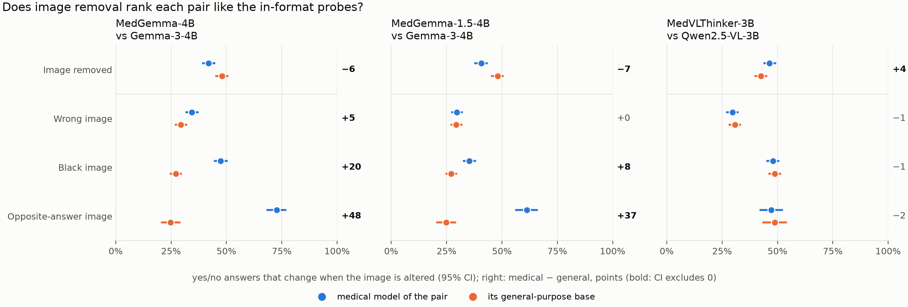

# Results: Consistent but Blind?

MedGemma-4B and its architecture-matched general-purpose twin Gemma-3-4B (plus two replication pairs, §9),
3,365 questions × 5.6 conditions on
average = **18,896 model calls per model** in the main run, plus **3,535 per model** for the registered probes;
all completed (RTX 4080 SUPER, bf16, batch 1). Primary set: the 1,206 yes/no **test** questions on 670 images.
All intervals are 95% cluster-bootstrap CIs by image (B = 2,000). **Pre-registered** results, **registered
probes** and **post-hoc** analyses are labelled as such; every change after the analysis plan was frozen is
logged in [PREREGISTRATION.md §13](PREREGISTRATION.md), and the probes were registered in [PREREGISTRATION.md §15](PREREGISTRATION.md) before they were run.
Tables: `results/<model>/main/`, `results/compare_medgemma4b_vs_gemma3_4b/main/`,
`results/posthoc_medgemma4b_vs_gemma3_4b/main/` (`medvlm analyze`, `compare`, `posthoc`). Paper:
[report/main.pdf](../report/main.pdf).

## Summary

1. **Image removal, the reference probe of the consistent-but-dangerous taxonomy, ranks MedGemma as the less
   image-reliant model.** Its Dangerous share is +13.7 points higher than Gemma-3's [10.0, 17.5] (P3), in every
   dataset and every cell of the pre-registered sensitivity grid.
2. **Every probe that keeps an image in the input ranks it as the more image-reliant model** (§5): it changes
   its answer more often under a wrong image (+5.1 [1.7, 8.5]), a black image (+20.3 [15.9, 24.6]) and an image
   on which the same question has the opposite answer (72.8% vs 24.8%, +48.0 [41.9, 53.8]).
3. **Two confounds explain the reversal** (§6). *Refusal:* without an image Gemma-3 would rather ask for it on
   354 of 1,206 questions (MedGemma 219), and its forced answers there are unrelated to its image answers
   (κ ≈ 0); allowed to say "unknown", both models decline on ≥ 93%. *Agreement between prior and image:*
   MedGemma's blind answers are informative (P1a), so they match its image answers wherever the image confirms
   the prior; its excess Dangerous answers are all correct (+14.1 correct, −0.4 wrong).
4. **The Dangerous share needs correcting before it means anything** (§7): a chance floor of 36–42% on yes/no
   questions (chance-corrected gap Δκ = +0.11 [0.04, 0.18]), a probe (the ranking flips between probes) and a
   correctness split.
5. **Image reliance does not flag wrong answers** (§8): AUROC 0.51, below the model's confidence (0.71).
6. **The reversal replicates where refusal differs** (§9, registered): MedGemma-1.5 vs Gemma-3 reverses again
   (+36.5 on opposite-answer images, −7.4 under image removal). MedVLThinker vs Qwen2.5-VL, whose models never
   refuse and do not differ under any in-format probe, does not.

## 1. Sanity checks

| | MedGemma-4B | Gemma-3-4B | Model card |
|---|---|---|---|
| SLAKE token-F1 (test, all questions) | **70.2** [67.5, 72.7] | 45.1 [42.1, 48.2] | MedGemma 72.3 · Gemma-3 40.2 |
| VQA-RAD token-F1 (test) | 64.6 [59.5, 69.4] | 45.0 [39.9, 50.3] | 49.9 · 33.6 (balanced split) |
| yes/no format mass, with image | ≥ 0.997 in every dataset | 1.000 | |

The pipeline reproduces MedGemma's published SLAKE score within 2.1 points. VQA-RAD is higher than the card,
which evaluates a harder "balanced" split. Both were anticipated in the pre-registration.

## 2. Accuracy with, without and with the wrong image (test, yes/no)

| | prior | MedGemma: image | no image | wrong image | Gemma-3: image | no image | wrong image |
|---|---|---|---|---|---|---|---|
| PathVQA | 52.2 | 65.5 | 57.2 | 51.0 | 63.2 | 53.5 | 46.7 |
| SLAKE | 50.7 | **86.5** | 47.6 | 67.0 | 68.7 | 47.6 | 62.3 |
| VQA-RAD | 53.0 | **81.3** | 60.6 | 70.5 | 56.2 | 55.4 | 60.2 |

## 3. Confirmatory tests

| | Test | Estimate [95% CI] | Outcome |
|---|---|---|---|
| | *Frozen before the main run* | | |
| **P1a** | MedGemma blind accuracy − majority prior, PathVQA | **+5.0** [0.9, 8.8] | p_Holm = 0.042 |
| **P1b** | … SLAKE | −3.1 [−7.8, 1.8] | p_Holm = 0.21 |
| **P1c** | … VQA-RAD | +7.6 [0.4, 14.5] | p_Holm = 0.072 |
| **P2** | AUROC(image PMI) − AUROC(confidence), MedGemma | **−0.197** [−0.250, −0.145] | reliance is worse |
| **P3** | Dangerous share, MedGemma − Gemma-3, image removed | **+13.7** [10.0, 17.5] | p < 0.001 (1,012 questions, 600 images) |
| | *Registered after the main run, before the probes (one Holm family)* | | |
| **H6** | κ(real, black image), MedGemma − Gemma-3 > 0 | −0.22 [−0.30, −0.14] | **failed, reversed**, p_Holm < 0.001 |
| **H7** | Declines with "unknown" allowed, MedGemma − Gemma-3 < 0 | −6.7 [−8.2, −5.3] | supported, p_Holm < 0.001 |
| **H8** | Follows an opposite-answer image, MedGemma − Gemma-3 > 0 | **+48.0** [41.9, 53.8] | supported, p_Holm < 0.001 |

Gemma-3's P1 values: +1.3 [−2.8, 5.3], −3.1 [−8.3, 2.3], +2.4 [−4.5, 9.2]; P2: −0.071 [−0.116, −0.026]. P2
is computed on the model's own answer; the registered formula used the gold answer, which is not available at
deployment and predicts correctness by construction (PREREGISTRATION.md §13, item 13).

## 4. The reference probe: quadrants and P3

Raw shares, as the taxonomy defines them. On yes/no questions they include chance agreement (§7) and correct
answers (§6), so a share near 50% is not "half the answers ignore the image".

| Dangerous share, test yes/no | PathVQA | SLAKE | VQA-RAD |
|---|---|---|---|
| MedGemma, image-removed probe | 50.6 | 46.8 | 56.5 |
| Gemma-3, image-removed probe | 43.2 | 28.1 | 31.0 |
| MedGemma, wrong-image probe | 46.6 | 64.7 | 61.9 |
| Gemma-3, wrong-image probe | 44.1 | 70.8 | 63.7 |

**P3.** MedGemma's Dangerous share is +13.7 points higher [10.0, 17.5], in every dataset (PathVQA +7.5
[2.6, 12.3], SLAKE +18.6 [12.2, 24.9], VQA-RAD +25.6 [14.7, 36.5]) and in every cell of the pre-registered
sensitivity grid. MedGemma is also the more **consistent** model (paraphrase flip rate 6.8% vs 13.6% on SLAKE,
19.3% vs 25.9% on PathVQA). Read at face value: the medical checkpoint is more often stable, confident and
blind. The next two sections show why that reading is wrong.

## 5. Four probes, one scale: the ranking reverses

Share of yes/no answers that change when the image is altered (`reversal.csv`; descriptive, post hoc as a
summary of the registered probes). A model that uses the image should change its answer when the image changes.

| Probe | n | MedGemma | Gemma-3 | MedGemma − Gemma-3 |
|---|---|---|---|---|
| Image removed (reference) | 1,206 | 42.0% [39.0, 44.9] | 48.0% [45.0, 50.8] | **−6.1** [−9.5, −2.7] |
| Wrong image, same modality | 1,206 | 34.4% [31.6, 37.4] | 29.4% [26.7, 32.3] | **+5.1** [1.7, 8.5] |
| Black image (R1) | 1,206 | 47.4% [44.3, 50.5] | 27.1% [24.4, 29.8] | **+20.3** [15.9, 24.6] |
| Opposite-answer image (R3, SLAKE) | 367 | 72.8% [68.1, 77.0] | 24.8% [20.4, 29.3] | **+48.0** [41.9, 53.8] |

**Opposite-answer image (R3, H8 supported).** The same question, asked about another image of the same modality
whose correct answer is the opposite. MedGemma follows the image on 73% of swaps and Gemma-3 on 25%, so
MedGemma is right on the new image 86.1% of the time and Gemma-3 61.0%. The gap holds for CT (75 vs 26%), MRI
(57 vs 26%) and X-ray (81 vs 8%; exploratory), and with the 40 PathVQA/VQA-RAD swaps added (69.8 vs 24.8%,
exploratory; the registered set is SLAKE's 367 questions on 130 images).

**Black image (R1, H6 failed and reversed).** Gemma-3 keeps the answer it gave with the real image on 72.9% of
questions, MedGemma on 52.6%; chance-corrected κ 0.33 [0.28, 0.39] vs 0.11 [0.06, 0.17]. Under this probe Gemma-3
is the more Dangerous model by 14.0 points [9.4, 18.6] (44.2% vs 58.2%). The answers explain it: on a black image
MedGemma's yes-rate drops from 58% to 28% (it reads an empty image as absent findings), while Gemma-3's rises
from 64% to 84%; its answers track the question rather than the image. H6 predicted the opposite.

**Wrong image.** A random image of the same modality changes MedGemma's answer more often (+5.1), while the
Dangerous share under this probe does not differ (−0.7 [−4.4, 3.2]). It is the weakest probe because a random
partner often has the same correct answer: where the partner image carries the same question, **all 23 chest
X-ray partners had the same correct answer** (CT 58%, MRI 60%), so an unchanged answer there is correct, not
blind. This is why the modality ordering reverses between probes:

Under image removal MedGemma's Dangerous share is ~50% for CT (50.8 [46.6, 55.6]) and MRI (50.0 [42.6, 57.4])
and lower for X-ray (33.1 [24.8, 41.2]); under a wrong image X-ray becomes the most "Dangerous" (75.4%). The two
main-run probes agree poorly (κ between their reliance labels: MedGemma 0.23, −0.11, 0.18; Gemma-3 0.07, 0.03,
0.07 for PathVQA, SLAKE, VQA-RAD), so a Dangerous share without its probe is underspecified.

## 6. Why image removal misranks

### Refusal

The pre-registered format check (yes+no first-token mass ≥ 0.9) failed in one condition only: **image removed**
(MedGemma 37–67% of questions below 0.9, Gemma-3 18–76%; with the image ≥ 99.8%). Free generation shows why:
*"Please provide the picture. I need to see the image to determine if there is a spinal cord present."*
(Gemma-3), *"I am unable to answer this question as I do not have access to medical images."* (MedGemma).
Counting mass < 0.5 as refusing, Gemma-3 refuses on 14 / 41 / 50% (PathVQA / SLAKE / VQA-RAD) and MedGemma on
10 / 26 / 27%; paired difference −11.2 points [−14.0, −8.6].

What a forced answer on a refused question does to the probe (`removal_split.csv`, post hoc):

| test yes/no | | n | answer changes without the image | κ(with, without image) | yes-rate without image |
|---|---|---|---|---|---|
| MedGemma | refuses (mass < 0.5) | 219 | 52.5% [45.5, 59.6] | 0.04 | 4% |
| | answers | 987 | 39.6% [36.5, 42.7] | 0.21 | 51% |
| Gemma-3 | refuses (mass < 0.5) | 354 | 55.4% [50.3, 60.7] | −0.01 | 8% |
| | answers | 852 | 45.0% [41.0, 48.8] | 0.11 | 48% |

On refused questions the forced answer is mostly "no" and unrelated to the answer with the image, so about half
of them count as "image-reliant". Gemma-3 has more of them.

**"Unknown" allowed (R2, H7 supported).** Without an image and with "unknown" allowed, MedGemma declines on 93.0%
(PathVQA 88%, SLAKE 98%, VQA-RAD 97%) and Gemma-3 on 99.7%; paired −6.7 [−8.2, −5.3]. The registered
"compliance-only" rule (gap < 3 points) is not met, so MedGemma keeps a small tendency to answer blind, mostly on
PathVQA. But most of the forced-format gap of 11.2 points disappears.

### Agreement between prior and image

Refusal is not the whole story. Removing questions on which either model refuses shrinks P3 to **+8.0**
[2.9, 13.3] (both answer, mass ≥ 0.9; n = 436) or +12.6 [8.1, 17.0] (neither refuses, mass ≥ 0.5; n = 699).
On these questions MedGemma's blind answers are informative:

- **Above the prior (P1).** MedGemma beats the majority-answer prior on PathVQA (Holm-significant); VQA-RAD is in
  the same direction but not after correction; SLAKE is not. Gemma-3 is never above the prior. Among questions
  MedGemma *does* answer without the image (mass ≥ 0.9), the margin grows to **+11.9** [7.1, 16.6] on PathVQA and
  **+15.7** [5.1, 25.3] on VQA-RAD (post hoc). Memorising the test set is unlikely: the margin appears on PathVQA
  and VQA-RAD, which MedGemma's model card does not list as training data, and **not** on SLAKE, which it does.
- **Agreement beyond chance.** On the questions each model answers, κ between its answers with and without the
  image is 0.21 for MedGemma and 0.11 for Gemma-3.

A model that looks at the image and whose prior predicts what the image shows gives the same answer with and
without it, and image removal scores that as blind. The correctness split (post hoc, `harm.csv`) shows that this
is what MedGemma's excess consists of:

| test yes/no, P3 set (n = 1,012) | MedGemma | Gemma-3 | Paired difference |
|---|---|---|---|
| Dangerous **and correct** | 39.2% | 25.1% | **+14.1** [11.1, 17.1] |
| Dangerous **and wrong** | 11.3% | 11.7% | −0.4 [−2.7, 2.0] |
| All errors | 25.7% | 37.6% | −12.0 [−15.5, −8.5] |
| Share of errors that are Dangerous | 43.8% | 31.0% | **+12.9** [6.0, 19.9] |

The opposite-answer probe (§5) removes this case by construction (the image contradicts the original answer),
and there MedGemma follows the image. **The residual concern** is subtler than "ignores the image": MedGemma errs
less, so more of its remaining errors (44% vs 31%) are stable, unchanged without the image and confident, and no
label-free check would flag them.

## 7. The chance floor

"Dangerous" counts an answer as image-independent whenever the no-image answer happens to equal the with-image
answer, which on yes/no questions happens often by chance. On the P3 set, MedGemma's answers are unchanged
without the image 58.6% of the time against 49.1% expected by chance from its yes-rates (Gemma-3: 49.7% vs
45.7%). Multiplying by each model's consistency gives a **chance-only Dangerous floor of 41.5% (MedGemma) and
35.8% (Gemma-3)**, against observed 50.5% and 36.8%. About 6 of the 13.7 points of P3 are the difference in
floors, partly because MedGemma is more consistent (84.5% vs 78.4%), a desirable property the metric counts
against it. The chance-corrected image-removal effect is Δκ = +0.112 [0.044, 0.180], p = 0.002 (`chance.csv`).

## 8. Does image reliance flag wrong answers? No

Each yes/no answer is scored by its image PMI, log p(answer | image) − log p(answer | no image) for the answer
the model gave: how much the image raised the probability of that answer. It ranks correct above incorrect
answers at chance (AUROC **0.513** [0.473, 0.552] for MedGemma, 0.532 for Gemma-3), while the model's own
confidence reaches 0.709 and 0.603 (**better by 0.197** [0.145, 0.250] and 0.071 [0.026, 0.116]). The
wrong-image variant is no better (0.52 / 0.54). *Whether a model leaned on the image does not tell you whether
it was right.*

## 9. Replication on two more pairs (registered, PREREGISTRATION.md §16)

Registered before any output of these models was seen: **pair A**, MedGemma-1.5-4B vs Gemma-3-4B (same family;
Gemma-3 outputs reused), and **pair B**, MedVLThinker-3B (Qwen2.5-VL-3B + RL on PMC-VQA) vs Qwen2.5-VL-3B-Instruct
(its base). Identical protocol: same questions, images, prompts, bf16, batch 1, probes and statistics. All three
new models passed the registered format check (yes/no mass with the image 0.93-0.999 on the pilot); the fallback
pair was not needed. 18,896 + 3,535 calls per model, all complete.

**Registered tests** (medical − general; one Holm family over pairs A and B; `results/replication_main.csv`):

| Pair | H9: follows opposite-answer image (> 0) | H10: answer changes without image (< 0) | H11: refuses without image (< 0) | Reversal replicates |
|---|---|---|---|---|
| Primary (reference) | +48.0 [41.9, 53.8] | −6.1 [−9.5, −2.7] | −11.2 [−14.0, −8.6] | |
| A: MedGemma-1.5 vs Gemma-3 | **+36.5** [30.6, 42.1], p_Holm < 0.001 | **−7.4** [−11.2, −3.7], p_Holm < 0.001 | **−28.7** [−31.6, −26.0], p_Holm < 0.001 | **yes** |
| B: MedVLThinker vs Qwen2.5-VL | −1.6 [−4.9, 1.4], p_Holm = 0.64 | +3.9 [1.7, 6.1] (wrong sign) | 0.0 (neither refuses) | **no** |

**All probes, all models** (share of test yes/no answers that change; `reversal.csv` per pair):

| | MedGemma-4B | MedGemma-1.5-4B | Gemma-3-4B | MedVLThinker-3B | Qwen2.5-VL-3B |
|---|---|---|---|---|---|
| Image removed | 42.0% | 40.6% | 48.0% | 46.4% | 42.5% |
| Wrong image | 34.4% | 29.7% | 29.4% | 29.7% | 30.8% |
| Black image | 47.4% | 35.3% | 27.1% | 47.9% | 48.8% |
| Opposite-answer image (SLAKE) | 72.8% | 61.3% | 24.8% | 47.1% | 48.8% |
| Refuses without image, forced yes/no | 18.2% | 0.7% | 29.4% | 0% | 0% |
| Declines with "unknown" allowed | 93.0% | 52.7% | 99.7% | 98.7% | 99.3% |
| Accuracy with image, SLAKE yes/no | 86.5% | 81.1% | 68.7% | 78.9% | 76.6% |

**Pair A replicates the reversal.** MedGemma-1.5 follows opposite-answer images far more than Gemma-3 and changes
more under a black image (+8.2 [3.7, 12.6]), but changes *less* when the image is removed, and its Dangerous share
under image removal is +9.8 [5.8, 13.9] higher. Refusal is even more lopsided than for MedGemma-4B (8 vs 354 of
1,206 questions), and on the 467 questions both models answer, the Dangerous gap shrinks to +3.0 [−3.6, 9.5]:
refusal accounts for nearly all of it. Unlike MedGemma-4B, MedGemma-1.5 answers blind even when allowed to decline
(it declines on 52.7%). Its excess Dangerous answers are again correct (+9.3 [5.7, 12.6] correct, +0.5 [−2.1, 3.2]
wrong).

**Pair B shows no reversal, because there is nothing to reverse.** MedVLThinker and its base are
indistinguishable under every in-format probe (opposite-answer −1.6, black −0.8 [−3.0, 1.3], wrong image −1.2
[−3.3, 1.0]) and in error rate (30.8% vs 31.7%): the RL fine-tune did not change how the model uses the image.
Neither model ever refuses under the forced format, and both decline on ≥ 98.7% when allowed to. Image removal
still reports a small difference the in-format probes do not see (+3.9, opposite to H10), because the base's blind
answers agree more with its image answers (κ 0.16 vs 0.09).

**Reading.** Across three pairs, image removal matched the in-format probes in none. It reversed their ranking in
both pairs whose models differ in refusal, and not in the pair whose models never refuse. Whether a medical
checkpoint uses the image more than its base is checkpoint-specific: both MedGemma releases do, MedVLThinker does
not. The refusal account was formed after the primary results; it fits all three pairs, but three pairs cannot
test it formally.

## 10. Hypotheses

| | Hypothesis | Outcome |
|---|---|---|
| H1 | Blind accuracy exceeds the prior somewhere, most likely PathVQA | **Supported** for MedGemma on PathVQA (P1a); not for Gemma-3 |
| H2 | Dangerous share differs by modality | **Probe-dependent:** X-ray is lowest under image removal and highest under wrong image, explained by answer-preserving swaps |
| H3 | Image PMI flags errors better than confidence | **Not supported:** at chance, below confidence |
| H4 | MedGemma has a larger Dangerous share than Gemma-3 | **Supported only under image removal** (robust to the grid and to refusals); null under a wrong image, **reversed** under a black image; the excess is correct answers |
| H5 | The two main-run probes agree only weakly | **Supported** (κ −0.11 to 0.23) |
| H6 | κ(real, black image) higher for MedGemma | **Failed, reversed:** −0.22 [−0.30, −0.14] |
| H7 | With "unknown" allowed, MedGemma still declines less | **Supported**, but both decline on ≥ 93% |
| H8 | MedGemma follows opposite-answer images more often | **Supported:** +48.0 [41.9, 53.8] |
| H9 | Replication pairs: the medical model follows opposite-answer images more | **Pair A supported** (+36.5); **pair B not** (−1.6) |
| H10 | Replication pairs: image removal ranks the pair the other way | **Pair A supported** (−7.4); **pair B not** (+3.9, opposite sign) |
| H11 | Replication pairs: the general model refuses more without the image | **Pair A supported** (−28.7); **pair B not** (neither refuses) |

## 11. Threats to validity

- Three pairs from two families: they show that image removal *can* misrank models and that refusal predicts
  when, not how often across the field. Checkpoints differ in their whole post-training, not only in medical data.
- The probes were registered after the main results were known (before running them); one of three
  predictions failed. R3 is limited to SLAKE, where templated questions recur across images.
- Refusal is inferred from first-token probability mass, confirmed by free generation on a sample, not annotated
  for every question.
- SLAKE is in MedGemma's training data (split unstated); VQA-RAD and PathVQA are not listed.
- Paraphrase equivalence was judged by an LLM (PREREGISTRATION.md §4.5) and not validated by human raters.
- Post-hoc analyses (chance correction, correctness split, refusal split, answer-change comparison, partner
  check) were motivated by the data and are reported as such.

## 12. Audit: leaks, confounds and wrong assumptions

No model is trained in this study; both are frozen and only queried. After the run we checked every path by
which the answer, or something correlated with it, could reach a model or a score, and every assumption the
conclusions rest on:

| Check | Finding | Effect on conclusions |
|---|---|---|
| Gold answer in the model input | None. The prompt is the question plus a fixed instruction; gold answers are used only *after* generation | none |
| Answer type (yes/no vs open) is derived from the gold answer and picks the instruction | Reveals the answer *format*, not the value; disagrees with the question's phrasing for 4 of 3,365 questions (dataset label errors) | negligible |
| Conditions differ only by the image | Verified on the rendered prompts: identical text for both models; with-image adds exactly 256 image tokens | none |
| Wrong-image partner | Never the same image, never another dataset or modality, chosen by a hash of the question ID | none; content confound in §5 |
| Opposite-answer partner | Same dataset, modality and normalised question; different image; opposite gold; chosen by a hash | none (unit-tested) |
| Paraphrase screening saw model outputs | No. Judged before the main run, from question text only | none |
| P2 formula | The registered version used the gold answer (log p(gold \| image) alone has AUROC 1.0); recomputed on the model's answer from stored outputs, no rerun needed | P2 reported on the model's answer |
| Dangerous share is not chance-corrected | On yes/no, 49% / 46% of answers would be "unchanged without the image" by chance | corrected with κ (§7) |
| Dangerous mixes correct and wrong answers | 78% of MedGemma's Dangerous answers are correct | split by correctness (§6) |
| Pilot questions (design tuned on them) are part of `main` | Without them: P1 PathVQA +6.3 [2.4, 10.6], p_Holm = 0.003; P3 +12.9 [8.9, 17.1]; wrong-image P3 −0.3 | none (`no_pilot.csv`) |
| Training-data contamination | Model card lists SLAKE, not VQA-RAD or PathVQA | SLAKE caveat; P1 pattern argues against it |
| Answer capitalisation, duplicates, prior | Case normalised; 5 duplicate pairs with conflicting gold (dataset noise); the test-set prior is the strongest constant baseline | none |
| `compare` pooled the validation split into P3 | Bug, fixed before reporting (+14.1 → +13.7) | fixed |
